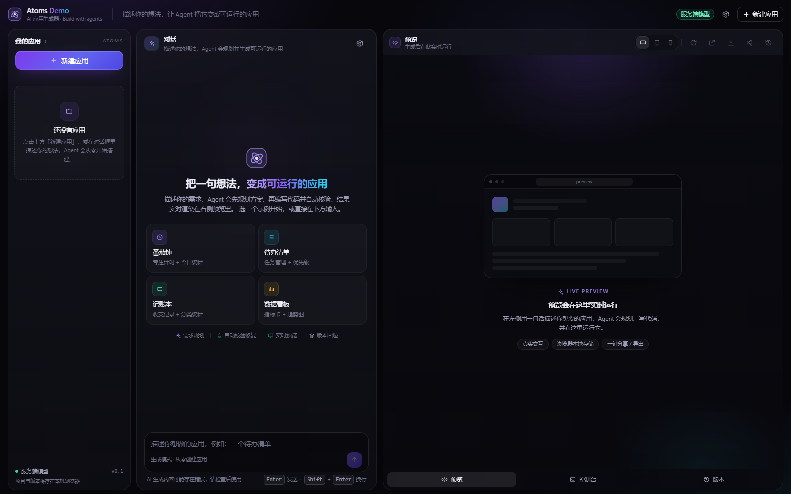
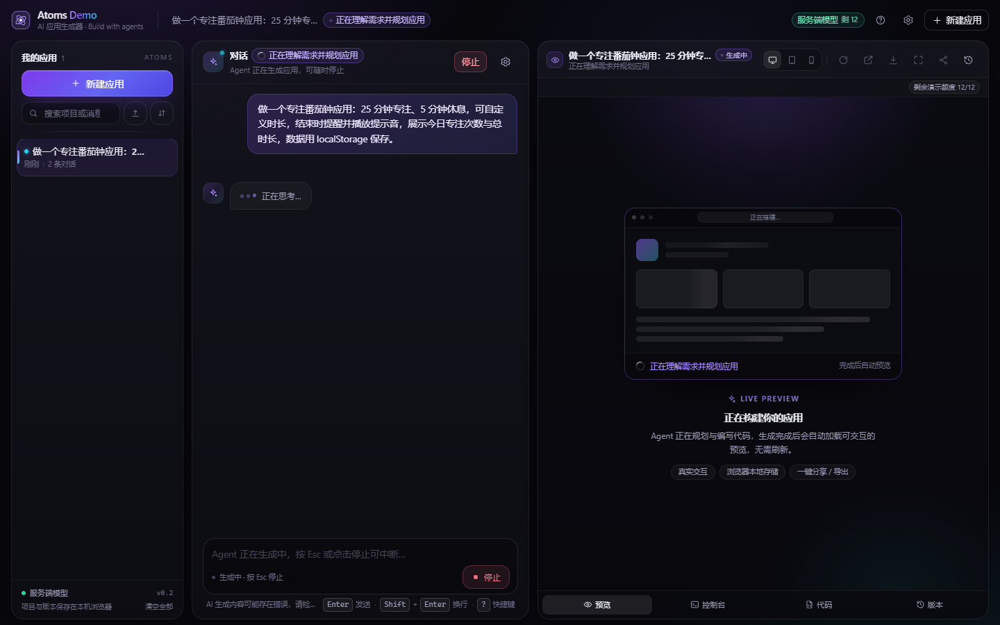
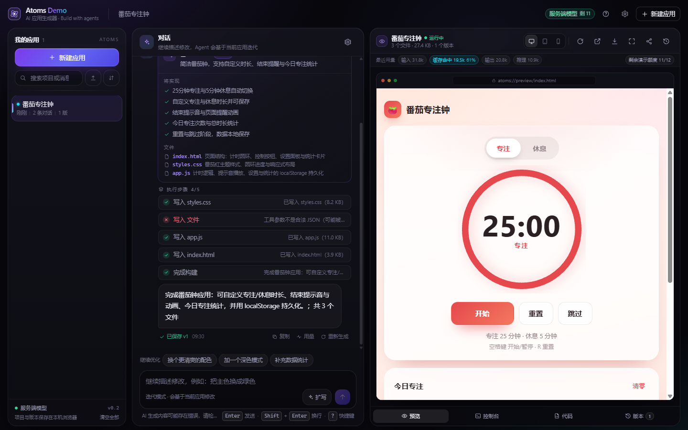
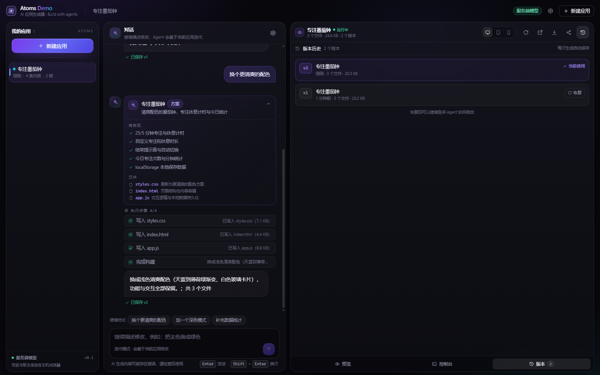
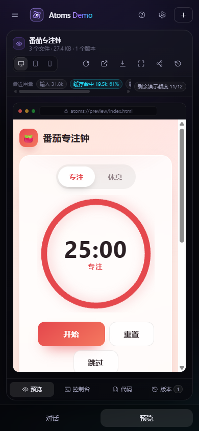

# Atoms Demo

> 一句话描述你的想法，AI Agent 帮你把可运行的应用写出来，并实时渲染在右侧预览区。继续对话即可迭代，每次生成都是一个可回滚的版本。

[](https://github.com/Luguoyn/atoms-demo)
[](https://nextjs.org/)
[](https://www.typescriptlang.org/)

**Atoms Demo** 是一个 AI App Builder 演示项目：服务端 Agent 负责「规划 → 写代码 → 校验 → 自动修复」，浏览器端负责「流式过程可视化 → iframe 实时预览 → 版本 / 分享 / 导出」。全部项目数据保存在浏览器本地（IndexedDB），**无需注册**；没有模型密钥时自动进入 **mock 演示模式**，任何人打开链接都能完整走通生成流程。

> 📎 在线演示：**https://newly-logan-edit-taxation.trycloudflare.com**（临时 quick-tunnel 链接，演示模式 + BYOK；长期演示请按 [docs/DEPLOY.md](./docs/DEPLOY.md) 部署）· 实现方案见 [docs/PLAN.md](./docs/PLAN.md) · 提交说明见 [docs/SUBMISSION.md](./docs/SUBMISSION.md)

---

## ✨ 功能

| 能力 | 说明 |
|---|---|
| 自然语言生成应用 | 输入「做一个番茄钟」「做一个记账小工具」等，Agent 产出计划、逐个写入 `index.html` / `styles.css` / `app.js`，生成物是**自包含静态应用**（无外链、可离线运行） |
| 实时流式过程 | SSE 事件流：`phase → plan → tool_start/file_delta → file_done → validation → done`，界面按事件渲染计划卡与工具步骤，生成过程可观察 |
| 实时预览 | 产物经 `buildPreviewDocument` 内联后注入 `iframe srcDoc + sandbox`，即生成即预览；带控制台面板捕获 iframe 内的 console/error |
| 多轮迭代 | 继续对话（如「把主色改成绿色」）→ refine 模式携带当前源码让 Agent 修改，预览实时更新 |
| 版本历史 | 每次生成保存一个版本，可一键回滚到任意历史版本 |
| 分享链接 | 应用文件压缩编码进 URL fragment（`#share=...`），**链接即应用**，无需后端存储 |
| 导出 | 单文件 HTML 或 ZIP（含应用源码），方便带走 |
| 设备预览 | 桌面 / 平板 / 手机视口切换，验证生成物响应式 |
| 无密钥演示模式 | 服务端无 key 时自动走确定性 mock agent（仍产生完整事件流与真实可用的示例应用），界面明确标注 |
| BYOK | 在设置里填自己的 OpenAI 兼容 Base URL / 模型 / Key（只保存在浏览器本地，仅本次请求发送给服务端转发） |
| 响应式界面 | ≥1280 桌面三栏布局，~390px 移动端折叠为抽屉式 |

## 📸 截图

| 首屏（欢迎态 + 示例 prompt） | 生成中（计划卡 + 工具步骤 + 实时预览） |
|---|---|
|  |  |

| 生成完成（iframe 实时预览） | 版本历史与回滚 |
|---|---|
|  |  |

| 移动端 ~390px |
|---|
|  |

## 🧱 技术栈

- **Next.js 15**（App Router，`src/` 目录）+ **React 19** + **TypeScript**（strict）
- **Tailwind CSS v4**（`@import "tailwindcss"`，无 `tailwind.config`）
- 服务端：Route Handler + **SSE** 流式输出，OpenAI 兼容 function calling（默认 DeepSeek `deepseek-chat`）
- 浏览器：IndexedDB（`idb-keyval`）持久化、iframe `srcDoc` + sandbox 预览、URL fragment 分享、`fflate` 导出 ZIP
- 零 UI 组件库，自建设计系统（深色 AI 产品风格：近黑底 + 紫色辉光 + 玻璃面板）

## 🏛 架构

```
┌──────────────────────────── Browser (Next.js client) ────────────────────────────┐
│  ProjectSidebar      ChatPanel                    PreviewPanel                    │
│  项目/新建/切换      消息流 · 计划卡 · 工具步骤     iframe 预览 · 设备 · 控制台 · 版本│
│        └─────────────────── useBuilder() store（唯一状态源）───────────────────┘   │
│                              │ fetch POST /api/chat (SSE)     │ buildPreviewDocument │
│                              │ IndexedDB 持久化              │ postMessage 控制台桥  │
└──────────────────────────────┼────────────────────────────────┼───────────────────┘
                               ▼                                ▲
┌────────────────────────── Server (Next Route Handler) ────────┴───────────────────┐
│ /api/chat → runAgent()                                                            │
│   provider（DeepSeek / 任意 OpenAI 兼容 / BYOK）⇄ tools(write_file, read_file, …)   │
│   → validate（node:vm 编译级 JS 语法、HTML 骨架、本地引用、体积上限）→ 最多 1 轮修复  │
│   → AgentEvent 流（SSE）                                                          │
│ 无 key 或 MOCK_LLM=1 → mock agent（确定性、真流式、内置高质量示例应用）             │
│ /api/config → { hasServerKey, mockMode, defaultModel }                            │
└───────────────────────────────────────────────────────────────────────────────────┘
```

数据（项目 / 消息 / 版本 / 设置）**只存在浏览器 IndexedDB**；服务端无状态、不落库，因此可以部署在任意 serverless 平台。

## 🚀 本地运行

要求：**Node.js ≥ 20.9**（推荐 24）、npm。Windows / macOS / Linux 均可。

```bash
# 1) 安装依赖
npm install

# 2) 配置环境变量（可选）
#    Windows PowerShell:
Copy-Item .env.example .env.local
#    macOS / Linux:
cp .env.example .env.local
#    不填 LLM_API_KEY 也能跑：会自动进入 mock 演示模式

# 3) 启动（默认 3000 端口）
npm run dev
# → http://localhost:3000
```

### 环境变量

| 变量 | 默认值 | 说明 |
|---|---|---|
| `LLM_BASE_URL` | `https://api.deepseek.com` | OpenAI 兼容的 API Base URL（DeepSeek / OpenAI / 任意兼容网关） |
| `LLM_MODEL` | `deepseek-chat` | 模型名 |
| `LLM_API_KEY` | 空 | 服务端密钥；**留空则自动 mock 演示模式**。请不要提交真实 key |
| `MOCK_LLM` | `0` | 设为 `1` 强制 mock（不调用模型，确定性演示） |
| `AGENT_BUDGET_MS` | `300000` | 单次生成的总时间预算（30s–900s clamp）。部署到有 60s 函数上限的平台时设为 `55000` 以内 |
| `LLM_REQUEST_TIMEOUT_MS` | `180000` | 单次模型 completion 超时（15s–600s clamp） |
| `LLM_IDLE_TIMEOUT_MS` | `60000` | 流式输出空闲超时（10s–300s clamp） |

> 安全：`.env*` 已被 gitignore；服务端不会把 key 写进日志或响应。BYOK 的 key 只保存在用户浏览器本地，随请求体传给本服务转发，不落盘。

### mock 演示模式 vs BYOK

| 场景 | 行为 | 界面 |
|---|---|---|
| 服务端有 `LLM_API_KEY` | 真实模型生成 | `serverMode = "server-key"` |
| 无服务端 key，或 `MOCK_LLM=1` | 内置 mock agent：确定性、真流式分段、产出完整示例应用 | `serverMode = "mock"`，界面标注演示模式 |
| 用户在设置里填了 key | 本次请求使用用户 key（BYOK） | `serverMode = "byok"` |

## 🧪 脚本

| 命令 | 作用 |
|---|---|
| `npm run dev` | 开发服务器（http://localhost:3000） |
| `npm run typecheck` | TypeScript 严格类型检查 |
| `npm run build` | 生产构建 |
| `npm run smoke -- --base http://localhost:3000` | HTTP 冒烟：校验 `/api/config` 结构与 `/api/chat` SSE 事件顺序/产物；无 key 时自动跳过 chat 并说明 |
| `node scripts/smoke.mjs --allow-real` | 服务端有真实 key 时显式跑一次真实生成（会消耗 token） |
| `powershell -ExecutionPolicy Bypass -File scripts/tunnel.ps1 -Detach` | 把本地 3000 端口暴露为公网 HTTPS 链接（cloudflared quick tunnel，无需账号） |
| `powershell -ExecutionPolicy Bypass -File scripts/tunnel.ps1 -Status` / `-Stop` | 查看 / 停止隧道 |

冒烟脚本退出码：`0` 通过 / `1` 断言失败 / `2` 连不上服务 / `3` 明确要求跑 chat 但被跳过（`--require-chat`）。详见脚本内 `--help`。

## 📁 项目结构

```
atoms/
├─ src/
│  ├─ app/
│  │  ├─ layout.tsx page.tsx globals.css      # 根布局 / 页面 / 设计系统 token
│  │  └─ api/
│  │     ├─ chat/route.ts                     # POST /api/chat → SSE 事件流
│  │     └─ config/route.ts                   # GET  /api/config → ServerConfig
│  ├─ components/
│  │  ├─ layout/       AppShell, TopBar       # 三栏壳 + 顶栏 + 移动端抽屉
│  │  ├─ chat/         ChatPanel, Composer, MessageItem, PlanCard, StepList, …
│  │  ├─ preview/      PreviewPanel, PreviewStage, ConsoleTab, VersionsTab, …
│  │  ├─ projects/     ProjectSidebar
│  │  ├─ settings/     SettingsDialog         # BYOK 设置
│  │  └─ ui/           Button, Modal, Badge, Spinner, Logo
│  ├─ lib/
│  │  ├─ agent/        provider, prompts, tools, validate, loop, mock  # 服务端 Agent
│  │  ├─ preview/      bundler.ts             # 文件内联 + 控制台桥 → iframe srcDoc
│  │  ├─ share/        shareLink.ts           # #share=base64url(deflate(files))
│  │  ├─ export/       exportApp.ts           # 导出 HTML / ZIP
│  │  ├─ store.tsx     idb.ts utils.ts        # 全局状态 / IndexedDB / 工具函数
│  └─ types.ts                                # 共享契约（AgentEvent / ChatRequest / …）
├─ scripts/
│  ├─ smoke.mjs                               # HTTP 冒烟（零依赖）
│  ├─ tunnel.ps1                              # 公网 HTTPS 隧道封装
│  └─ agent-smoke.mjs                         # Agent 引擎离线冒烟
├─ docs/                 CONTRACT / PLAN / SUBMISSION / DEPLOY
├─ tools/                cloudflared.exe 等本地工具（运行时下载）
└─ vercel.json
```

## 🏁 评测维度对照

| 维度 | 本项目的体现 |
|---|---|
| **完成度** | 生成 → 实时预览 → 多轮迭代 → 版本回滚 → 刷新恢复 → 分享/导出 全链路可跑；`typecheck` / `build` 通过；SSE 异常与中断有兜底 |
| **工程思维** | 契约先行（`src/types.ts` 事件协议）；编译级校验 + 1 轮自修复；mock 降级；无状态服务端便于部署；文档记录取舍 |
| **用户体验** | 深色 Atoms 风格界面、流式打字、计划卡与工具步骤可视化、设备预览、控制台、快捷键、~390px 响应式 |
| **创新性** | 无密钥演示模式；分享链接即应用；版本回滚；生成物控制台；一键导出单文件 HTML/ZIP |
| **可交付性** | README + [部署文档](./docs/DEPLOY.md) + 公网隧道脚本 + 冒烟脚本 + 提交说明（[docs/SUBMISSION.md](./docs/SUBMISSION.md)） |

## 📦 部署

首选 **Vercel**（GitHub 导入 + 设环境变量，一键 HTTPS），也支持 Netlify / Render / Docker 自托管，以及本地 cloudflared 快速隧道。完整步骤、环境变量清单、SSE 与超时注意事项见 **[docs/DEPLOY.md](./docs/DEPLOY.md)**。

## 📚 文档索引

- [docs/CONTRACT.md](./docs/CONTRACT.md) — 团队契约：产品定义、API/状态/组件边界、验收标准
- [docs/PLAN.md](./docs/PLAN.md) — 实现方案与架构
- [docs/SUBMISSION.md](./docs/SUBMISSION.md) — 提交说明（思路、完成度、后续规划）
- [docs/DEPLOY.md](./docs/DEPLOY.md) — 部署与公网演示链接

## 已知限制

- 生成物是**静态应用**（HTML/CSS/JS），不含后端与数据库；复杂需求会退化为前端实现。
- 单次生成限制：最多约 10 个 Agent 步骤 / `AGENT_BUDGET_MS`（默认 300s，可配）/ 单文件 200KB；**超时或中断时若已产出文件，会降级为「已生成可用版本（部分完成）」而不是报错丢弃**。
- 预览 iframe 使用 `sandbox` 隔离（不放行 `allow-same-origin`），因此生成物在**预览内**的 `localStorage` 是内存垫片（刷新预览不保留数据）；「在新窗口打开」或以导出文件运行时是真实持久化。这是为了隔离生成物与宿主应用数据的取舍。
- 项目数据在浏览器本地：换浏览器/设备不同步（分享链接与导出可跨设备传递应用）。
- 公网隧道链接是临时的（quick tunnel 每次启动 URL 都不同），长期演示请用正式部署。
- 演示模式（无服务端 key）下生成结果为内置高质量模板 + 确定性流式；配置服务端 `LLM_API_KEY` 或在设置里填 BYOK 即为真实模型生成。
