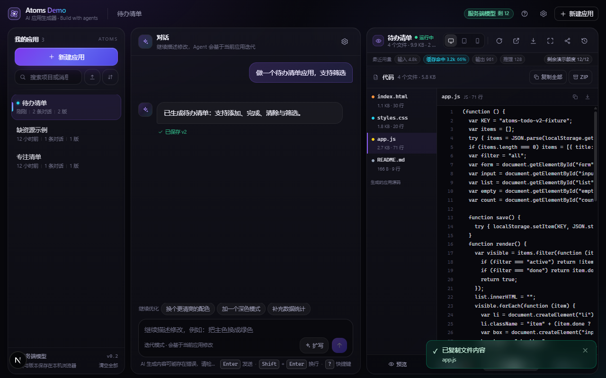
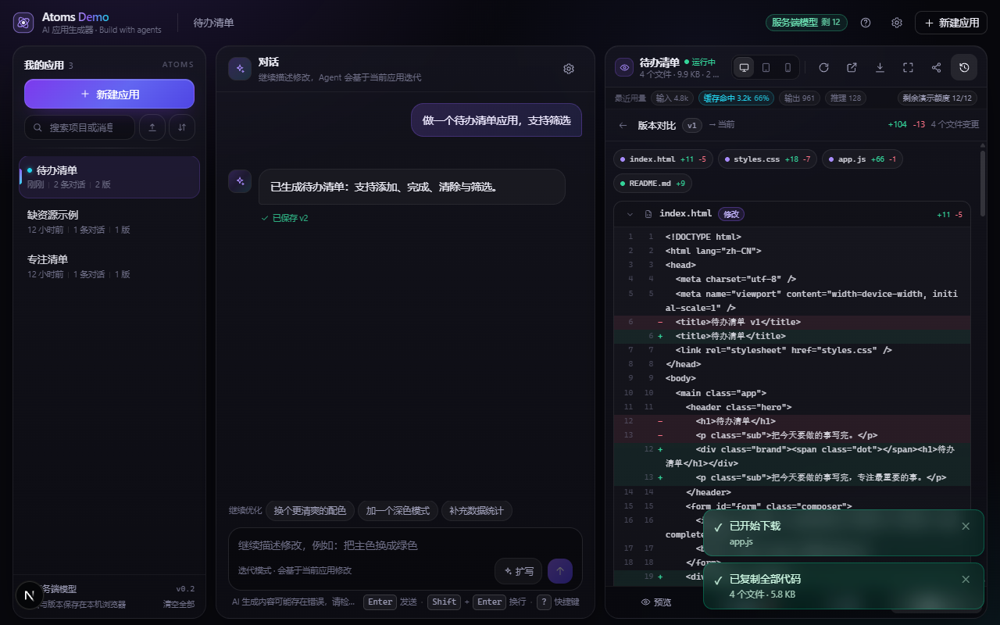
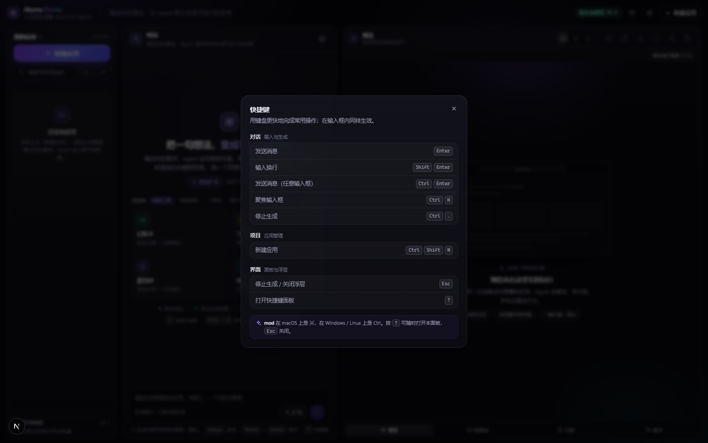
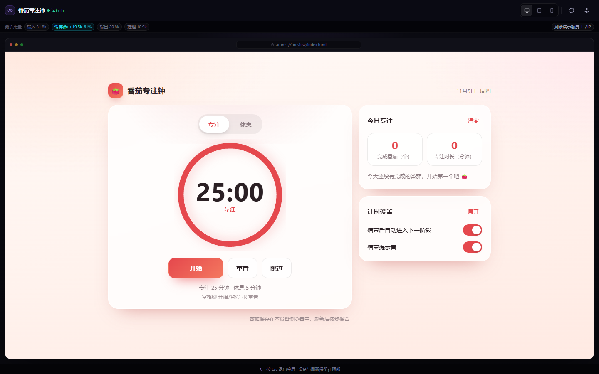
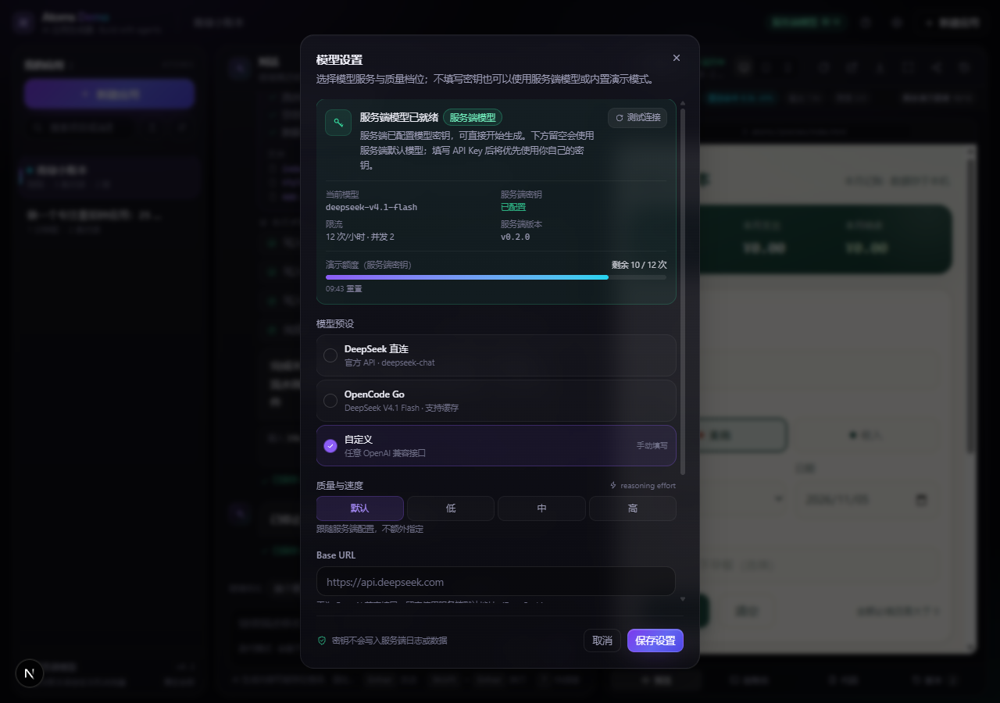

# Atoms Demo

> 一句话描述你的想法，AI Agent 帮你把可运行的应用写出来，并实时渲染在右侧预览区。继续对话即可迭代，每次生成都是一个可回滚的版本。

[](https://github.com/Luguoyn/atoms-demo)
[](https://nextjs.org/)
[](https://www.typescriptlang.org/)

**Atoms Demo** 是一个 AI App Builder 演示项目：服务端 Agent 负责「规划 → 写代码 → 校验 → 自动修复」，浏览器端负责「流式过程可视化 → iframe 实时预览 → 版本 / 分享 / 导出」。全部项目数据保存在浏览器本地（IndexedDB），**无需注册**；没有模型密钥时自动进入 **mock 演示模式**，任何人打开链接都能完整走通生成流程。

**v0.2 增强**：快捷键面板、消息复制/重试/重新生成/编辑重发、项目搜索与 JSON 导入导出、灵感库与「帮我扩写」、设置里的模型预设/质量档/额度、预览**代码 tab**、**版本 diff**、**全屏预览**、控制台筛选、Token 用量与缓存命中展示，以及完整的[产品文档](./docs/PRODUCT.md)。

> 📎 在线演示：**https://atoms-demo-wine.vercel.app**（Vercel 正式部署，Hobby 计划；服务端密钥真实生成 + 每 IP 限流/并发上限；也可在设置里填自己的 key（BYOK）绕过演示额度；push 到 `main` 自动部署）· 产品文档见 [docs/PRODUCT.md](./docs/PRODUCT.md) · 接口见 [docs/API.md](./docs/API.md)

---

## ✨ 功能

### 核心生成与预览

| 能力 | 说明 |
|---|---|
| 自然语言生成应用 | 输入「做一个番茄钟」「做一个记账小工具」等，Agent 产出计划、逐个写入 `index.html` / `styles.css` / `app.js`，生成物是**自包含静态应用**（无外链、可离线运行） |
| 实时流式过程 | SSE 事件流：`phase → plan → tool_start/file_delta → file_done → validation → usage → done`，界面按事件渲染计划卡与工具步骤，生成过程可观察 |
| 实时预览 | 产物经 `buildPreviewDocument` 内联后注入 `iframe srcDoc + sandbox`，即生成即预览；带控制台面板捕获 iframe 内的 console/error |
| 多轮迭代 | 继续对话（如「把主色改成绿色」）→ refine 模式携带当前源码让 Agent 修改，预览实时更新 |
| 版本历史 + diff | 每次生成保存一个版本，可一键回滚；支持与当前版本做文件级/行级差异对比 |
| 分享链接 | 应用文件压缩编码进 URL fragment（`#share=...`），**链接即应用**，无需后端存储 |
| 导出 / 导入 | 导出单文件 HTML 或 ZIP；项目可导出/导入 JSON，跨浏览器搬运 |
| 设备预览 + 全屏 | 桌面 / 平板 / 手机视口切换；全屏沉浸预览（Esc 退出） |
| 代码浏览 | 「代码」tab 查看/复制/下载 3 个生成文件（ZIP 全量） |
| 无密钥演示模式 | 服务端无 key 时自动走确定性 mock agent（仍产生完整事件流与真实可用的示例应用），界面明确标注 |
| BYOK | 在设置里填自己的 OpenAI 兼容 Base URL / 模型 / Key（只保存在浏览器本地，仅本次请求发送给服务端转发） |
| 服务端状态与配额 | `GET /api/status` 返回模式/模型/限流/剩余额度；公开演示按 IP 限流（默认 12 次/小时），额度用完可 BYOK 继续 |
| 用量与缓存可见 | 每次生成展示 `prompt / cached / output` tokens 与 reasoning 档位 |
| 响应式界面 | ≥1280 桌面三栏布局，~390px 移动端折叠为底部「对话 / 预览」切换 |

### v0.2 新增（易用性 / 可观测性）

| 能力 | 说明 |
|---|---|
| 快捷键 + 快捷键面板 | `?` 打开面板；`mod+k` 聚焦输入框、`mod+Enter` 发送、`Esc` 停止生成/关闭浮层（完整列表见下方「快捷键」章节） |
| Toast 统一反馈 | 分享 / 复制 / 导出 / 保存设置 / 项目导入导出 / 提示词增强都有成功或失败提示 |
| 消息操作 | assistant：复制、重新生成、查看用量；user：编辑并重发；错误消息：重试 |
| 项目侧栏增强 | 搜索（名称/消息内容）、排序、复制项目、导出/导入 JSON、删除全部 |
| 灵感库 + 帮我扩写 | 分类示例 prompt（效率工具/数据看板/小游戏/展示页）与「换一批」；`/api/prompt/enhance` 把一句话扩写成完整需求 |
| 设置增强 | 模型预设（DeepSeek 直连 / OpenCode Go / 自定义）、质量-速度档（reasoningEffort）、服务端状态卡片（模式/模型/剩余额度/版本）、测试连接 |
| 预览代码 tab | 文件树 + 源码（行号/等宽字体）、单文件复制/下载、复制全部、下载 ZIP |
| 版本 diff | 「对比」按钮打开差异视图：文件级新增/删除/修改 + 行级 `+/-` 高亮与统计 |
| 全屏预览 | 覆盖视口的沉浸预览，Esc 退出，保留设备切换/刷新 |
| 控制台增强 | 级别筛选（全部/log/warn/error）、错误计数徽标、复制日志、自动滚动开关 |
| 提示词缓存实测 | `scripts/cache-probe.mjs` 验证 OpenCode Go prompt cache；数据见 [PRODUCT.md §8.4](./docs/PRODUCT.md#84-prompt-cache-实测opencode-go--deepseek-v41-flash) |

## 📸 截图

| 首屏（欢迎态 + 灵感库） | 生成中（计划卡 + 工具步骤 + 实时预览） |
|---|---|
|  |  |

| 生成完成（iframe 实时预览 + 用量/额度） | 版本历史与回滚 |
|---|---|
|  |  |

| 移动端 ~390px |
|---|
|  |

**v0.2 新增界面**

| 代码 tab（文件树 + 源码） | 版本 diff（文件级 / 行级对比） |
|---|---|
|  |  |

| 快捷键面板（`?`） | 全屏预览 |
|---|---|
|  |  |

| 设置与额度（服务端状态 / 质量档 / BYOK） |
|---|
|  |

## ⌨️ 快捷键

| 快捷键 | 作用 |
|---|---|
| `Enter` | 发送消息 |
| `Shift+Enter` | 输入换行 |
| `mod+Enter` / `Ctrl+Enter` | 发送消息（任意输入框） |
| `mod+k` / `Ctrl+k` | 聚焦输入框 |
| `Esc` | 停止生成 / 关闭浮层 |
| `?` | 打开快捷键面板 |
| `mod+shift+n` | 新建应用 |
| `mod+.` | 停止生成 |

> `mod` = Windows/Linux 的 `Ctrl` 或 macOS 的 `⌘`；面板内容与代码同源（`src/lib/hotkeys.ts` 的 `SHORTCUTS`），按 `?` 随时查看。

## 🧱 技术栈

- **Next.js 15**（App Router，`src/` 目录）+ **React 19** + **TypeScript**（strict）
- **Tailwind CSS v4**（`@import "tailwindcss"`，无 `tailwind.config`）
- 服务端：Route Handler + **SSE** 流式输出，OpenAI 兼容 function calling；已验证默认配置 **OpenCode Go + DeepSeek V4.1 Flash**（`deepseek-v4.1-flash`，reasoning + tool calling），也支持 DeepSeek 直连等任意兼容网关
- 浏览器：IndexedDB（`idb-keyval`）持久化、iframe `srcDoc` + sandbox 预览、URL fragment 分享、`fflate` 导出 ZIP
- 交互：自研快捷键系统（`src/lib/hotkeys.ts`）+ 统一 Toast + 版本 diff（纯前端行级算法，无新依赖）
- 零 UI 组件库，自建设计系统（深色 AI 产品风格：近黑底 + 紫色辉光 + 玻璃面板）

## 🏛 架构

```
┌──────────────────────────── Browser (Next.js client) ────────────────────────────┐
│  ProjectSidebar      ChatPanel                    PreviewPanel                    │
│  搜索/排序/导入导出   消息流·计划卡·工具步骤·操作   iframe · 代码 · 控制台 · 版本    │
│        └─────────────────── useBuilder() store（唯一状态源）───────────────────┘   │
│           │ fetch /api/chat (SSE) · /api/status · /api/prompt/enhance              │
│           │ IndexedDB 持久化                │ buildPreviewDocument → iframe srcDoc  │
└───────────┼─────────────────────────────────┼──────────────────────────────────────┘
            ▼                                 ▲
┌────────────────────────── Server (Next Route Handlers) ──────────────────────────┐
│ /api/chat → ratelimit(per-IP quota + concurrent) → runAgent()                     │
│   provider（OpenCode Go / DeepSeek / 任意 OpenAI 兼容 / BYOK）⇄ tools(write_file…) │
│   → validate（node:vm 编译级校验 + 外链白名单）→ 最多 2 轮修复 → AgentEvent 流      │
│     含 usage 事件（prompt / cached / output tokens）与 X-RateLimit-* 响应头        │
│ /api/config → { hasServerKey, mockMode, defaultModel }                            │
│ /api/status → { mode, model, quota, rateLimits, version }                         │
│ /api/prompt/enhance → 一句话需求扩写（BYOK → 服务端 key → mock 兜底）              │
│ 无 key 或 MOCK_LLM=1 → mock agent（确定性、真流式、内置高质量示例应用）             │
└───────────────────────────────────────────────────────────────────────────────────┘
```

数据（项目 / 消息 / 版本 / 设置）**只存在浏览器 IndexedDB**；服务端无状态、不落库，因此可以部署在任意 serverless 平台。

## 🚀 本地运行

要求：**Node.js ≥ 20.9**（推荐 24）、npm。Windows / macOS / Linux 均可。

```bash
# 1) 安装依赖
npm install

# 2) 配置环境变量（可选）
#    Windows PowerShell:
Copy-Item .env.example .env.local
#    macOS / Linux:
cp .env.example .env.local
#    不填 LLM_API_KEY 也能跑：会自动进入 mock 演示模式

# 3) 启动（默认 3000 端口）
npm run dev
# → http://localhost:3000
```

### 环境变量

| 变量 | 默认值 | 说明 |
|---|---|---|
| `LLM_BASE_URL` | `https://api.deepseek.com` | OpenAI 兼容的 API Base URL（DeepSeek / OpenAI / 任意兼容网关） |
| `LLM_MODEL` | `deepseek-chat` | 模型名 |
| `LLM_API_KEY` | 空 | 服务端密钥；**留空则自动 mock 演示模式**。请不要提交真实 key |
| `MOCK_LLM` | `0` | 设为 `1` 强制 mock（不调用模型，确定性演示）；此时仍允许用户 BYOK |
| `LLM_CODING_MAX_TOKENS` | `24000` | 写代码单轮输出上限（1000–32000 clamp）；reasoning 模型会占用其中一部分 |
| `LLM_CODING_MAX_TOKENS_CAP` | `32000` | 输出被截断后自动升预算重试的上限（8000–32000 clamp） |
| `LLM_TRUNCATION_RETRIES` | `2` | 单次生成内「升预算重试」次数（0–4 clamp，0 = 关闭自动重试） |
| `LLM_PLAN_MAX_TOKENS` | `3000` | 规划单轮输出上限（500–16000 clamp） |
| `LLM_REASONING_EFFORT` | 空 | reasoning 模型可选 `low/medium/high/max`（`minimal` 会被映射为 `low`）；`low` 在代码生成任务上约快 2.5 倍 |
| `LLM_USER_AGENT` / `LLM_EXTRA_HEADERS` | 空 | 网关自定义请求头；对 `opencode.ai` 端点会自动附加稳定的 `x-opencode-session` |
| `AGENT_BUDGET_MS` | `300000` | 单次生成的总时间预算（30s–900s clamp）。部署到有 60s 函数上限的平台时设为 `55000` 以内 |
| `LLM_REQUEST_TIMEOUT_MS` | `180000` | 单次模型 completion 超时（15s–600s clamp） |
| `LLM_IDLE_TIMEOUT_MS` | `60000` | 流式输出空闲超时（10s–300s clamp） |
| `RATE_LIMIT_PER_HOUR` | `12` | 公开演示时每个 IP 每小时可用服务端密钥生成的次数（BYOK 请求不计数） |
| `RATE_LIMIT_CONCURRENT` | `2` | 同时进行中的服务端密钥生成数上限（超过返回 429 + 友好提示） |
| `PROMPT_ENHANCE_PER_HOUR` / `PROMPT_ENHANCE_MAX_TOKENS` | `30` / `2400` | 「帮我扩写」每 IP 每小时次数与单次输出预算（独立于生成配额） |

> **已验证的默认模型配置：OpenCode Go + DeepSeek V4.1 Flash**（reasoning + function calling）
> ```bash
> LLM_BASE_URL=https://opencode.ai/inference/go/openai/v1
> LLM_MODEL=deepseek-v4.1-flash
> LLM_API_KEY=oc_sk_...        # OpenCode Go 订阅的 API Key
> LLM_CODING_MAX_TOKENS=24000
> LLM_CODING_MAX_TOKENS_CAP=32000
> LLM_TRUNCATION_RETRIES=2
> LLM_PLAN_MAX_TOKENS=4000
> LLM_REASONING_EFFORT=low
> ```
> 实测：真实生成一次应用约 **40–70s**（3 个文件、校验通过；复杂需求触发截断自动重试时约 2–3 分钟）；同为 OpenAI 兼容接口，切回 `https://api.deepseek.com` + `deepseek-chat` 只需改这 3 个变量。

> 安全：`.env*` 已被 gitignore；服务端不会把 key 写进日志或响应。BYOK 的 key 只保存在用户浏览器本地，随请求体传给本服务转发，不落盘。

### mock 演示模式 vs BYOK

| 场景 | 行为 | 界面 |
|---|---|---|
| 服务端有 `LLM_API_KEY` | 真实模型生成 | `serverMode = "server-key"` |
| 无服务端 key，或 `MOCK_LLM=1` | 内置 mock agent：确定性、真流式分段、产出完整示例应用 | `serverMode = "mock"`，界面标注演示模式 |
| 用户在设置里填了 key | 本次请求使用用户 key（BYOK） | `serverMode = "byok"` |

## 🧪 脚本

| 命令 | 作用 |
|---|---|
| `npm run dev` | 开发服务器（http://localhost:3000） |
| `npm run typecheck` | TypeScript 严格类型检查 |
| `npm run build` | 生产构建 |
| `npm run smoke -- --base http://localhost:3000` | HTTP 冒烟：`/api/config`、`/api/status`、`/api/chat` SSE（事件顺序 + `usage` + 限流头）、`/api/prompt/enhance`；无 key 时自动跳过真实生成并说明 |
| `node scripts/smoke.mjs --allow-real` | 服务端有真实 key 时显式跑真实生成 + 提示词增强（会消耗 token） |
| `node scripts/agent-smoke.mjs`（`MOCK_LLM=1`） | Agent 引擎离线冒烟（mock 分支，不消耗额度） |
| `node scripts/cache-probe.mjs` | prompt cache 实测：同一 session 发两次递增请求，打印 cached tokens |
| `powershell -ExecutionPolicy Bypass -File scripts/tunnel.ps1 -Detach` | 把本地 3000 端口暴露为公网 HTTPS 链接（cloudflared quick tunnel，无需账号） |
| `powershell -ExecutionPolicy Bypass -File scripts/tunnel.ps1 -Status` / `-Stop` | 查看 / 停止隧道 |

冒烟脚本退出码：`0` 通过 / `1` 断言失败 / `2` 连不上服务 / `3` 明确要求跑 chat 但被跳过（`--require-chat`）。详见脚本内 `--help`。

## 📁 项目结构

```
atoms/
├─ src/
│  ├─ app/
│  │  ├─ layout.tsx page.tsx globals.css      # 根布局 / 页面 / 设计系统 token
│  │  └─ api/
│  │     ├─ chat/route.ts                     # POST /api/chat → SSE 事件流（含 usage / 限流头）
│  │     ├─ config/route.ts                   # GET  /api/config → ServerConfig
│  │     ├─ status/route.ts                   # GET  /api/status → 模式 / 配额 / 限流
│  │     └─ prompt/enhance/route.ts           # POST /api/prompt/enhance → 需求扩写
│  ├─ components/
│  │  ├─ layout/       AppShell, TopBar       # 三栏壳 + 顶栏 + 移动端抽屉 + 全局快捷键
│  │  ├─ chat/         ChatPanel, Composer, MessageItem, PlanCard, StepList,
│  │  │                WelcomeScreen（灵感库）, ShortcutsDialog
│  │  ├─ preview/      PreviewPanel, PreviewStage, CodeTab, ConsoleTab, VersionsTab（含 diff）, DiffView
│  │  ├─ projects/     ProjectSidebar         # 搜索 / 排序 / 导入导出
│  │  ├─ settings/     SettingsDialog         # 模型预设 / 质量档 / 额度 / BYOK
│  │  └─ ui/           Button, Modal, Badge, Spinner, Logo, Toast
│  ├─ lib/
│  │  ├─ agent/        provider, prompts, tools, validate, loop, mock, ratelimit  # 服务端 Agent
│  │  ├─ preview/      bundler.ts             # 文件内联 + 控制台桥 → iframe srcDoc
│  │  │                diff.ts                # 版本行级 diff（纯函数）
│  │  ├─ share/        shareLink.ts           # #share=base64url(deflate(files))
│  │  ├─ export/       exportApp.ts           # 导出 HTML / ZIP / 项目 JSON
│  │  ├─ store.tsx     idb.ts utils.ts hotkeys.ts
│  └─ types.ts                                # 共享契约（AgentEvent / ServerStatus / …）
├─ scripts/
│  ├─ smoke.mjs                               # HTTP 冒烟（零依赖）
│  ├─ agent-smoke.mjs                         # Agent 引擎离线冒烟
│  ├─ cache-probe.mjs                         # prompt cache 实测
│  └─ tunnel.ps1                              # 公网 HTTPS 隧道封装
├─ docs/                 PRODUCT / API / FAQ / CHANGELOG / CONTRACT / PLAN / SUBMISSION / DEPLOY
│  └─ screenshots/       README 用截图
├─ tools/                cloudflared.exe 等本地工具（运行时下载，gitignored）
└─ vercel.json
```

## 🏁 评测维度对照

| 维度 | 本项目的体现 |
|---|---|
| **完成度** | 生成 → 实时预览 → 多轮迭代 → 版本回滚/diff → 刷新恢复 → 分享/导出/导入 全链路可跑；`typecheck` / `build` 通过；SSE 异常、中断、配额与并发超限都有兜底与明确文案 |
| **工程思维** | 契约先行（`src/types.ts` 事件协议）；编译级校验 + 自动修复；mock 降级；无状态服务端便于部署；限流/配额、usage 与缓存可观测；文档记录取舍 |
| **用户体验** | 深色 Atoms 风格界面、流式打字、计划卡与工具步骤可视化、消息操作、快捷键、Toast、代码/控制台/版本四 tab、全屏预览、~390px 响应式 |
| **创新性** | 无密钥演示模式；分享链接即应用；版本 diff 与回滚；生成物控制台；Token 用量与 prompt cache 可见；导出单文件 HTML/ZIP |
| **可交付性** | README + 完整产品文档（PRODUCT/API/FAQ/CHANGELOG）+ [部署文档](./docs/DEPLOY.md) + 公网隧道脚本 + 冒烟脚本 + 提交说明 |

## 📦 部署

首选 **Vercel**（GitHub 导入 + 设环境变量，一键 HTTPS），也支持 Netlify / Render / Docker 自托管，以及本地 cloudflared 快速隧道。完整步骤、环境变量清单、SSE 与超时注意事项见 **[docs/DEPLOY.md](./docs/DEPLOY.md)**。

## 📚 文档索引

**产品文档**
- [docs/PRODUCT.md](./docs/PRODUCT.md) — **产品说明（核心）**：定位/用户旅程/功能矩阵/交互设计/状态机与错误处理/架构与 SSE 协议/数据模型/模型与成本（含 prompt cache 实测）/配置/性能/测试策略/路线图
- [docs/API.md](./docs/API.md) — 接口参考：`/api/config`、`/api/status`、`/api/chat`(SSE)、`/api/prompt/enhance`，含 curl 示例、错误码、限流头
- [docs/FAQ.md](./docs/FAQ.md) — 常见问题（无 key 使用、数据存储、失败排查、BYOK、额度、部署、分享、缓存…）
- [docs/CHANGELOG.md](./docs/CHANGELOG.md) — 版本变更记录（v0.1.0 / v0.2.0 / v0.2.1）

**工程与交付**
- [docs/DEPLOY.md](./docs/DEPLOY.md) — 部署与公网访问（Vercel / Netlify / Render / Docker / 隧道）
- [docs/CONTRACT.md](./docs/CONTRACT.md) — 团队技术契约（v1 核心 + v2 增强轮）
- [docs/PLAN.md](./docs/PLAN.md) — 实现方案与架构
- [docs/SUBMISSION.md](./docs/SUBMISSION.md) — 笔试提交说明（思路、完成度、后续规划）

## 已知限制

- 生成物是**静态应用**（HTML/CSS/JS），不含后端与数据库；复杂需求会退化为前端实现。
- 单次生成限制：最多约 10 个 Agent 步骤 / `AGENT_BUDGET_MS`（默认 300s，可配）/ 单文件 200KB；**超时或中断时若已产出文件，会降级为「已生成可用版本（部分完成）」而不是报错丢弃**。
- 预览 iframe 使用 `sandbox` 隔离（不放行 `allow-same-origin`），因此生成物在**预览内**的 `localStorage` 是内存垫片（刷新预览不保留数据）；「在新窗口打开」或以导出文件运行时是真实持久化。这是为了隔离生成物与宿主应用数据的取舍。
- 项目数据在浏览器本地：换浏览器/设备不同步（分享链接与导出可跨设备传递应用）。
- 公网隧道链接是临时的（quick tunnel 每次启动 URL 都不同），长期演示请用正式部署。
- 演示模式（无服务端 key）下生成结果为内置高质量模板 + 确定性流式；配置服务端 `LLM_API_KEY` 或在设置里填 BYOK 即为真实模型生成。
- 公开演示的服务端限流/额度为**进程内存**实现（单实例有效；多实例/serverless 需共享存储）。
