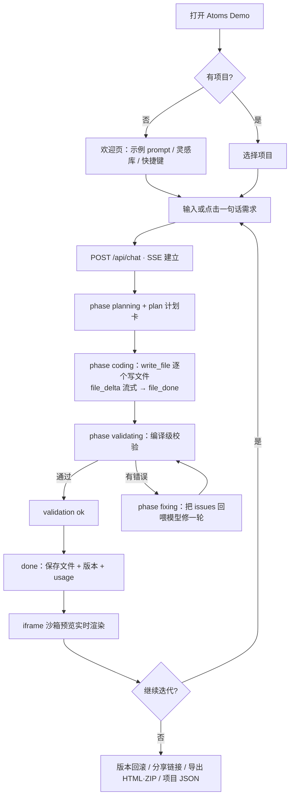
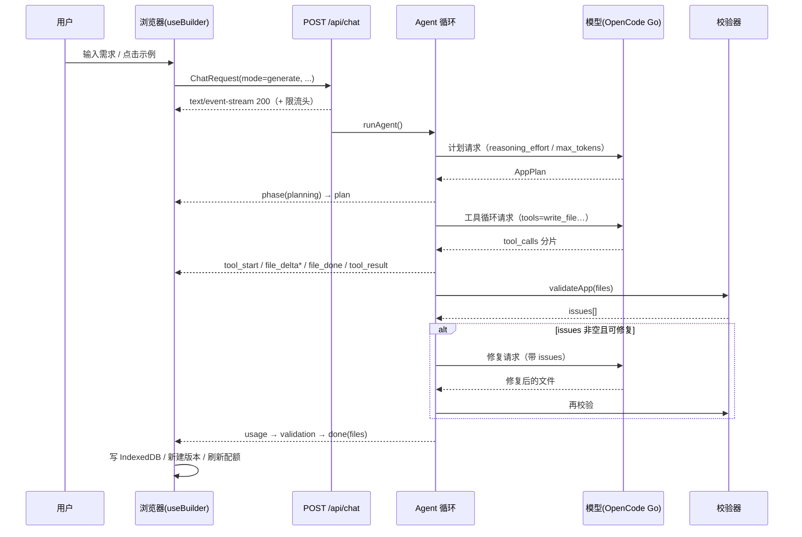
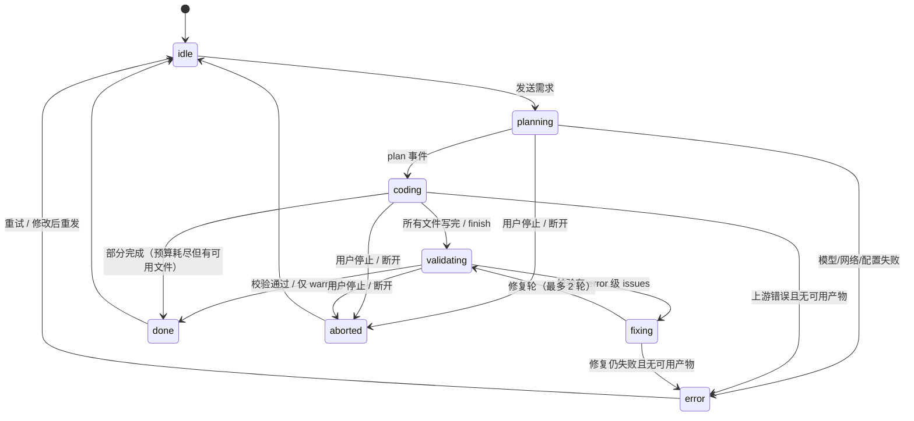
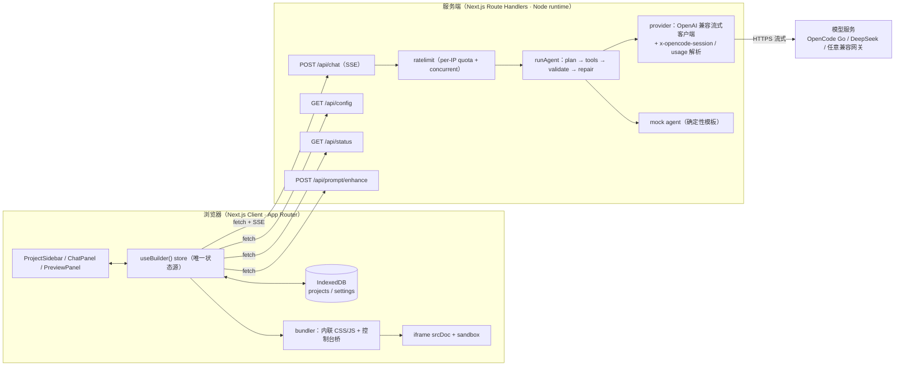

# Atoms Demo 产品文档（v0.2）

> 文档定位：给**评测者 / 面试官 / 使用者**看的完整产品说明，覆盖「是什么、给谁用、怎么用、怎么实现、成本多少、边界在哪」。
> 对应代码版本：`v0.2.0`（master @ 2026-11-05）｜技术契约见 [CONTRACT.md](./CONTRACT.md)｜接口见 [API.md](./API.md)｜部署见 [DEPLOY.md](./DEPLOY.md)｜变更见 [CHANGELOG.md](./CHANGELOG.md)｜FAQ 见 [FAQ.md](./FAQ.md)

---

## 目录

1. [产品概述](#1-产品概述)
2. [使用场景与用户旅程](#2-使用场景与用户旅程)
3. [功能矩阵](#3-功能矩阵)
4. [交互设计](#4-交互设计)
5. [生成状态机与错误处理](#5-生成状态机与错误处理)
6. [系统架构与 SSE 事件协议](#6-系统架构与-sse-事件协议)
7. [数据模型](#7-数据模型)
8. [模型与成本（含 prompt cache 实测）](#8-模型与成本含-prompt-cache-实测)
9. [配置项](#9-配置项)
10. [性能与稳定性](#10-性能与稳定性)
11. [测试策略](#11-测试策略)
12. [已知限制](#12-已知限制)
13. [路线图](#13-路线图)

---

## 1. 产品概述

### 1.1 一句话定位

**Atoms Demo 是一个「一句话生成可运行应用」的 AI App Builder 演示**：用户用自然语言描述需求，服务端 Agent 完成「规划 → 写代码 → 校验 → 自动修复」，浏览器端把生成过程实时可视化，并把产出的应用立即渲染在右侧预览区；用户可以继续对话迭代，每次生成都会成为可回滚的版本。

成功的标准不是「生成了几行代码」，而是：**评测者打开链接 10 秒内就知道怎么玩，1 分钟内看到第一个可交互的应用，之后会主动想再改一次。**

### 1.2 目标用户

| 用户 | 典型诉求 | 本产品如何满足 |
|---|---|---|
| **面试 / 笔试评测者** | 快速判断工程能力与产品 sense | 打开链接即用（无注册、无 key 也能完整跑）；生成过程、版本、分享、导出都可现场验证 |
| **产品经理 / 设计同学** | 30 分钟内把想法变成可点击原型 | 一句话生成 + 对话迭代 + 设备预览，无需写代码 |
| **开发者 / 创客** | 快速搭 demo、验证交互想法 | 生成物是纯静态文件，可导出 HTML/ZIP 带走继续改 |
| **教学场景** | 演示「Agent + 流式 UI + 沙箱预览」如何工作 | 计划卡、工具步骤、校验/修复、Token 用量全部可见可讲解 |

### 1.3 解决什么问题

- **从想法到可交互结果太慢**：传统流程要写脚手架、调样式、跑构建；本产品把「想法 → 能点的应用」压缩到一次生成（mock ~5s / 真实模型约 1 分钟）。
- **AI 生成代码不可信、过程不可见**：我们让 Agent 先给出计划（AppPlan），再逐个写文件，最后做编译级校验与一轮自修复；每一步都以事件流呈现，出错有明确文案与重试入口。
- **生成结果的运行环境难隔离**：生成物在浏览器内以 `iframe srcDoc + sandbox` 运行，既不会污染宿主页面，也能把 `console.log` / 运行时错误回传到控制台。
- **演示/评审时没有模型额度**：内置 mock agent 让「无 key」场景也能完整体验；有自己 key 的评测者可以 BYOK 走真实模型。

### 1.4 与 Atoms 的关系与差异

本项目是 [Atoms](https://atoms.dev)（AI 应用生成器）核心体验的**独立复刻 Demo**，用于笔试交付，不是官方产品。

| 维度 | Atoms 官方产品 | 本 Demo |
|---|---|---|
| 定位 | 面向团队的生产级 App Builder | 6–8h 内可交付、可评测的单体 Demo |
| 生成物 | 多文件工程 / 前后端 | **自包含静态应用**（`index.html` + `styles.css` + `app.js`），可离线运行、可导出 |
| 持久化 | 云端账号 + 数据库 | 浏览器 IndexedDB（免注册、服务端无状态） |
| 模型 | 平台托管 | 任意 OpenAI 兼容模型（默认 OpenCode Go · DeepSeek V4.1 Flash），支持 BYOK 与 mock 降级 |
| 协作 | 团队空间/评论 | 分享链接（URL 内编码应用）+ JSON 导入导出 |
| 部署 | 官方托管 | Vercel / Netlify / Render / Docker / 本地隧道 |

**设计边界**：刻意不生成带后端/数据库的应用，也不在浏览器里跑构建器。用「静态应用 + 沙箱预览 + 版本/分享/导出」把 6–8 小时能打磨好的体验做深，而不是摊大饼。

### 1.5 设计原则

1. **过程可观察**：计划、工具调用、流式写入、校验结果都对用户可见，避免「黑盒转圈」。
2. **失败可恢复**：所有失败都有明确原因与下一步（重试 / 改 key / 降低质量档 / 换 prompt）；已生成的文件不丢。
3. **零门槛试用**：无注册、无 key 也能完成完整闭环（mock 模式）。
4. **数据主权**：项目数据只存在用户浏览器；BYOK 的 key 只在本地保存并随请求转发，不落服务端。
5. **演示导向**：首屏 3 秒内给出可点的示例 prompt；移动端可操作。

---

## 2. 使用场景与用户旅程

### 2.1 场景一：快速原型验证（产品经理 / 设计师）

> 「我下午要跟客户过一版『专注番茄钟』的想法，需要能点的东西。」

1. 打开首页 → 点「番茄钟」示例 prompt（自动填入并发送）。
2. Agent 先给出计划卡（应用名 / 一句话说明 / 功能点 / 要写的文件）。
3. 左侧消息流逐步显示「写入 styles.css → app.js → index.html」，右侧预览从骨架变为真实应用。
4. 生成完成：预览可点击操作，版本自动保存为 `v1`。
5. 继续输入「主色改成绿色，再加一个今日统计」→ 迭代出 `v2`。
6. 点「分享」得到一条链接，发给客户；或导出 ZIP 存档。

**价值**：30 分钟内完成从想法到可演示原型，且过程可截图给客户看。

### 2.2 场景二：教学 / 作品演示（评测者 / 讲师）

> 「我想展示 Agent 是怎么一步步写出一个应用的。」

- 生成过程中观察：计划卡（AppPlan）、每个文件的写入步骤、校验（validation）事件、错误修复（fixing）阶段。
- 切换「控制台」「代码」「版本」tab：看生成物运行时日志、源码、版本差异。
- 在设置里切换 reasoning 档位（低/中/高）感受速度-质量差异；查看每次生成的 `usage`（输入/输出/缓存命中 tokens）。
- 用 mock 模式（`MOCK_LLM=1`）在无外网/无额度环境下稳定演示。

### 2.3 场景三：内部小工具（运营 / 开发）

> 「需要一个记账小工具/数据看板，不想发需求排期。」

1. 输入「做一个记账本，支持收入/支出分类、按月统计、数据存本地」。
2. 生成后导出**单文件 HTML**，丢进内网共享盘或公众号附件，双击即用（生成物只依赖 localStorage）。
3. 后续要改？把导出的 JSON 重新导入（项目导入），继续对话迭代。

### 2.4 主流程



### 2.5 一次生成的时间线（真实模型）



---

## 3. 功能矩阵

> 状态说明：✅ 已上线（可现场验证）；🚧 本轮交付（v0.2 新增）；🗺️ 规划中（未实现，不夸大）。

### 3.1 核心生成与预览

| 能力 | 状态 | 一句话价值 |
|---|---|---|
| 一句话生成可运行静态应用（HTML/CSS/JS 三文件） | ✅ v0.1 | 从想法到能点的应用 |
| 服务端 Agent：规划 → 工具写码 → 校验 → 自动修复 | ✅ v0.1 | 不是一次 LLM 调用，而是可解释的 Agent 流程 |
| SSE 流式过程可视化（计划卡 / 工具步骤 / 文件流式写入） | ✅ v0.1 | 生成过程不黑盒 |
| iframe `srcDoc + sandbox` 实时预览 | ✅ v0.1 | 即生成即预览，隔离安全 |
| 多轮迭代（refine 携带当前源码） | ✅ v0.1 | 「把主色改成绿色」即可改 |
| 版本历史 + 回滚 | ✅ v0.1 | 每次生成可回退 |
| 刷新持久化（IndexedDB） | ✅ v0.1 | 关掉浏览器再回来还在 |
| 设备预览（桌面/平板/手机视口） | ✅ v0.1 | 验证生成物响应式 |
| 控制台面板（捕获 iframe console/error） | ✅ v0.1 | 生成物运行错误可见 |
| 分享链接（URL fragment 压缩编码） | ✅ v0.1 | 链接即应用，无需后端 |
| 导出单文件 HTML / ZIP | ✅ v0.1 | 生成物可带走 |
| 无 key mock 演示模式 | ✅ v0.1 | 零门槛体验完整闭环 |
| BYOK（自带模型 key） | ✅ v0.1 | 评测者可用自己的 key 真实生成 |
| 移动端 ~390px 适配 | ✅ v0.1 | 手机上也能生成/预览 |

### 3.2 v0.2 新增（易用性 / 功能 / 可观测性）

| 能力 | 状态 | 一句话价值 |
|---|---|---|
| 全局快捷键 + `?` 快捷键面板 | 🚧 v0.2 | 键盘流操作，可发现 |
| Toast 统一反馈（成功/失败） | 🚧 v0.2 | 操作结果不再静默 |
| 消息操作：复制 / 重试 / 重新生成 / 编辑重发 | 🚧 v0.2 | 对话可控、可纠错 |
| 项目搜索 / 排序 / 复制 / 删除全部 | 🚧 v0.2 | 项目多了也找得到 |
| 项目导出/导入 JSON | 🚧 v0.2 | 跨浏览器/跨设备搬运项目 |
| 灵感库（分类示例 + 换一批） | 🚧 v0.2 | 不知道写什么也能开始 |
| 「帮我扩写」提示词增强（`/api/prompt/enhance`） | 🚧 v0.2 | 一句话变可执行需求 |
| 设置增强：模型预设 / 质量档（reasoningEffort）/ 测试连接 | 🚧 v0.2 | 换模型、调速度-质量更简单 |
| 服务端状态与额度（`/api/status` + 剩余额度展示） | 🚧 v0.2 | 公开演示的配额透明 |
| 代码 tab：文件树 + 源码查看/复制/下载 | 🚧 v0.2 | 生成物不再是黑盒 |
| 版本 diff：文件级 + 行级差异 | 🚧 v0.2 | 「这轮改了什么」一目了然 |
| 全屏预览（Esc 退出） | 🚧 v0.2 | 演示/移动端专注看应用 |
| 控制台增强：级别筛选 / 错误计数 / 复制日志 / 自动滚动 | 🚧 v0.2 | 排错更快 |
| 用量与缓存展示（input / cached / output tokens） | 🚧 v0.2 | 成本可见、缓存可见 |
| Token 用量事件（SSE `usage`）与 `X-RateLimit-*` 响应头 | 🚧 v0.2 | 客户端可感知成本与配额 |
| reasoningEffort 请求参数（低/中/高/最高） | 🚧 v0.2 | 质量-速度可调 |
| 产品文档套件（PRODUCT/API/CHANGELOG/FAQ） | 🚧 v0.2 | 交付完整度 |

### 3.3 规划中（本 Demo 不做，路线图见 §13）

| 能力 | 状态 | 说明 |
|---|---|---|
| 多文件工程（React/Vue 项目、构建产物） | 🗺️ | 需要沙箱构建器，超出本轮边界 |
| 生成物后端/数据库（API + 存储） | 🗺️ | 当前生成物为纯前端静态应用 |
| 账号体系 / 云端同步 / 团队协作 | 🗺️ | 与「免注册 + 本地存储」定位冲突，暂不做 |
| 从截图 / Figma 导入生成 | 🗺️ | 需要视觉理解链路 |
| 生成物一键发布托管 | 🗺️ | 当前通过分享链接/导出交付 |
| 会话内增量 diff 编辑（当前整文件重写） | 🗺️ | 更省 token，但实现复杂度高 |
| 生成质量回归集（多 prompt 自动评分） | 🗺️ | 测试策略见 §11.4 |

---

## 4. 交互设计

### 4.1 页面结构

**桌面（≥ 1024px）：三栏**

```
┌──────────────────────────────────────────────────────────────────────────┐
│ TopBar：Logo / 当前项目名 · 模式徽标(服务端模型/演示模式/BYOK) / 设置 / 新建应用 │
├──────────────┬───────────────────────────────┬───────────────────────────┤
│ ProjectSidebar│ ChatPanel                     │ PreviewPanel              │
│ 搜索 / 排序   │ 消息流（用户/AI/计划/步骤）     │ 工具栏：设备·刷新·打开·导出·分享·全屏│
│ 新建/重命名   │ 错误 banner / 生成状态条        │ iframe 预览 / 代码 / 控制台 / 版本│
│ 复制/删除     │ Composer（输入 + 停止 + 扩写）   │ 用量条（input/cached/output）     │
│ 导入/导出     │ 快捷键提示 `?`                  │                           │
└──────────────┴───────────────────────────────┴───────────────────────────┘
```

**移动端（< 768px）**：单栏 + 底部「对话 / 预览」分段切换；项目列表收进左侧抽屉（顶栏「打开项目列表」按钮）；预览工具栏自适应换行，生成中的关键状态（阶段 / 停止）保持可见。

### 4.2 快捷键

来源：`src/lib/hotkeys.ts` 的 `SHORTCUTS`（UI 面板与本文档同源，避免文档漂移）。

| 快捷键 | 作用 | 分组 |
|---|---|---|
| `Enter` | 发送消息（输入框内） | 对话 |
| `Shift+Enter` | 输入换行 | 对话 |
| `mod+Enter`（Ctrl/Cmd+Enter） | 发送消息（任意输入框） | 对话 |
| `mod+k` | 聚焦输入框 | 对话 |
| `Esc` | 停止生成 / 关闭浮层 | 界面 |
| `?` | 打开快捷键面板 | 界面 |
| `mod+shift+n` | 新建应用 | 项目 |
| `mod+.` | 停止生成 | 对话 |

> 说明：`mod` 在 Windows/Linux 为 `Ctrl`，macOS 为 `⌘`；快捷键面板本身也由 `?` 打开、`Esc` 关闭。

### 4.3 消息操作

- **assistant 消息**（完成态）hover 显示操作：
  - `复制`：复制消息正文（Markdown）。
  - `重新生成`：重跑该条消息对应的需求（`regenerateFrom`）。
  - `查看用量`：输入 / 输出 / 缓存命中 tokens（有 usage 时）。
- **user 消息**：
  - `编辑并重发`：行内编辑后作为新一轮请求（`editAndResend`）。
- **错误消息**：红色系统消息样式 + 「重试」按钮（`retryLast`）+ 错误原因文案（见 §5.3）。
- **生成中**：Composer 变为「停止」按钮；输入框禁用；状态条显示当前 phase（如「正在编写样式、交互与页面结构」）。

### 4.4 预览面板：四个 tab

| tab | 内容 | 关键交互 |
|---|---|---|
| **预览** | 设备外壳 + iframe（srcDoc） | 设备切换（桌面/平板/手机）、刷新、新窗口打开、全屏、生成中遮罩 |
| **控制台** | iframe 内 console/error 日志 | 级别筛选（全部/log/warn/error）、错误计数徽标、复制日志、清空、自动滚动开关 |
| **代码** | 文件树 + 源码（行号、等宽字体） | 单文件复制/下载、复制全部、下载 ZIP、空态提示 |
| **版本** | 版本卡片列表（时间/大小/当前版本） | 恢复版本、与当前版本对比（diff：文件级 + 行级 +/-） |

**全屏预览**：工具栏「全屏」→ 覆盖视口（Esc 退出），保留设备切换 / 刷新 / 关闭；移动端同样可用。

**用量与额度**：预览工具栏显示最近一次生成的 `输入 x / 缓存命中 y / 输出 z tokens`；服务端密钥模式下另外显示「剩余演示额度 n」。

### 4.5 工具栏动作

| 动作 | 行为 |
|---|---|
| 刷新预览 | 重新构建 srcDoc（不重新生成） |
| 新窗口打开 | 以 blob URL 打开生成应用（真实 localStorage，可持久化） |
| 导出 | 下拉：单文件 HTML / ZIP（含源码与 README） |
| 分享 | 生成 `#share=...` 链接并复制到剪贴板（超长时提示） |
| 版本历史 | 切到版本 tab |
| 全屏 | 进入沉浸预览（Esc 退出） |

### 4.6 设置与模型

设置弹窗（右上角「模型设置」）包含：

- **模型预设**：DeepSeek 直连 / OpenCode Go / 自定义（一键填充 Base URL + 模型名）。
- **质量档（reasoningEffort）**：默认 / 低 / 中 / 高；随 `settings` 持久化，并作为 `/api/chat` 请求参数。
- **服务端状态卡片**：当前模式（服务端密钥 / BYOK / 演示模式）、模型名、剩余演示额度与重置时间、限流上限；「测试连接」按钮刷新状态并 toast 结果。
- **BYOK 表单**：Base URL / 模型名 / API Key（密码框，可显示/清除）；留空则使用服务端配置或 mock。
- **安全说明**：key 只保存在浏览器 IndexedDB，随请求体转发给本服务，不落盘、不写日志。

### 4.7 项目侧栏

- 搜索框：按项目名 / 最近消息内容过滤。
- 排序：最近更新 / 创建时间。
- 项目操作：切换、重命名（inline）、删除（二次确认）、复制项目、导出 JSON。
- 全局操作：导入项目 JSON（文件选择，失败 toast）、删除全部项目（二次确认）、新建应用。
- 空态：说明「新建应用」与示例 prompt 入口。

### 4.8 灵感库与提示词增强

- 欢迎态示例按分类展示（效率工具 / 数据看板 / 小游戏 / 展示页），每类 3–4 个，「换一批」随机。
- 点击示例卡片 = 填入并发送；也可只填入再编辑。
- Composer 的「帮我扩写」调用 `POST /api/prompt/enhance`：把一句话需求扩写为可直接投喂生成 Agent 的完整需求（含功能点、交互、视觉与约束），结果写回输入框并 toast；失败时保留原文并提示。

### 4.9 反馈与状态

- **Toast**：所有成功/失败操作（分享、复制、导出、恢复版本、保存设置、项目导入导出、扩写）统一走 `useToast()`；同时最多 3 条、自动消失、可手动关闭。
- **空态**：无项目（侧栏）/ 无消息（欢迎页）/ 无预览（骨架 + 引导）/ 无控制台日志 / 无版本。
- **错误态**：红色系统消息 + 错误原因 + 重试；顶部 banner 用于全局错误（如配额用尽）。
- **生成态**：阶段徽标 + 步骤 spinner + 预览遮罩（显示 phaseLabel，不遮挡已有内容）。

### 4.10 响应式与可访问性

- ≥1280px：三栏；1024–1280px：三栏压缩；<768px：单栏 + 底部切换。
- 所有交互元素有 `aria-label` / 语义标签；快捷键面板可键盘操作；尊重 `prefers-reduced-motion`（动效降级）。

---

## 5. 生成状态机与错误处理

### 5.1 状态机



**阶段与 UI 文案（示例）**

| phase | 状态条文案 | 预览区 |
|---|---|---|
| `planning` | 正在分析需求、制定实现方案 | 骨架屏 + 「正在构建你的应用」 |
| `coding` | 正在编写样式、交互与页面结构 | 保持上一版内容（如有） |
| `validating` | 正在校验产物 | 同上 |
| `fixing` | 发现问题，正在自动修复 | 同上 |
| `done` | 已生成「应用名」，包含完整的页面、样式与交互 | 新应用渲染 |
| `aborted` | 已停止生成（可重试） | 保留已生成内容 |

### 5.2 客户端状态字段

`useBuilder()` 暴露：`busy`、`phase`、`phaseLabel`、`error`、`lastUsage`、`serverStatus`；消息级 `status: streaming | done | error`；步骤级 `running | done | error`。

### 5.3 错误分类与用户文案

| 类别 | 触发 | 用户看到的文案/动作 | 是否可重试 |
|---|---|---|---|
| 配置错误 `config` | 无 key 且 mock 关闭、Base URL 非法 | 「缺少 API Key / 接口地址不合法，请在设置中检查」 | 否（改配置） |
| 鉴权失败 `auth` | 401/403/402 | 「模型服务鉴权失败 / 余额不足，请检查 key 或账户额度」 | 否（换 key） |
| 请求被拒 `bad_request` | 400/404/422（模型名错、参数不支持） | 「模型或接口不存在，请检查 LLM_BASE_URL / LLM_MODEL」 | 否（改配置） |
| 上游限流 `rate_limit` | 模型服务 429 | 「模型服务限流，请稍后重试」 | 是 |
| 网络错误 `network` | DNS/连接失败/断网 | 「无法连接模型服务」 | 是 |
| 超时 `timeout` | 单轮 180s 超时 / 空闲 60s 超时 | 「模型响应超时 / 长时间无输出，已中止」 | 是 |
| 上游不可用 `upstream` | 5xx | 「模型服务暂时不可用」 | 是 |
| 中止 `aborted` | 用户点停止 / 关闭页面 | 「已停止生成」，保留已产出文件 | 是（重试/继续） |
| 校验失败 | 修复后仍有 error 级 issues | done 中带 issues；UI 提示「部分内容可能有问题，可让 Agent 继续修复」 | 是 |
| 演示配额 429 | 服务端密钥模式，本 IP 每小时次数用尽 | 「本小时演示额度已用完（上限 N 次/小时），请稍后再试；也可在设置里填自己的 API Key 继续使用」+ Reset 时间 | 等重置 / BYOK |
| 并发上限 429 | 同时在生成的人数达上限 | 「当前同时生成的人较多，请等几秒再试」+ `Retry-After` | 是（等待） |
| 请求体非法 400 | 消息过长/文件超限 | 「message 过长（上限 8000 字）」等 | 否（改输入） |
| SSE 断流 | 网络中断 / 代理超时 | 客户端将消息标记 error，提示重试；已收到的文件保留 | 是 |

> 服务端所有错误信息都不包含 API key（provider 层统一脱敏 `sk-***`）；BYOK 的 key 不会出现在任何响应/日志中。

### 5.4 停止、部分完成与重试语义

- **停止（Esc / mod+. / 停止按钮）**：中断前端 fetch → 服务端 `request.signal` abort → provider 连接关闭；已写入内存的文件通过 `file_done` 事件保留，若至少有可用文件则落为「部分完成」版本（`done` 带提示，不报错丢弃）。
- **重试**：错误消息上的「重试」= 用相同需求新建一轮（不覆盖历史）；「重新生成」= 针对指定 assistant 消息对应的需求重跑。
- **编辑重发**：修改用户消息文本后重发，旧消息保留在历史中（不删除版本）。
- **刷新恢复**：进行中的生成不跨刷新恢复（流已中断），但已保存的项目/消息/版本完整恢复。

### 5.5 配额与限流（公开演示）

公开演示默认使用**服务端密钥**，为避免被刷爆额度，服务端内置内存限流：

| 限制 | 默认 | 环境变量 | 行为 |
|---|---|---|---|
| 每 IP 每小时生成次数 | 12 | `RATE_LIMIT_PER_HOUR` | 超过返回 `429` + `Retry-After`，文案提示 BYOK |
| 同时进行中的生成数 | 2 | `RATE_LIMIT_CONCURRENT` | 超过返回 `429` + `Retry-After: 10` |
| 提示词增强次数 | 30 次/小时/IP（简单限流） | — | 超过返回 `429` |

- BYOK 请求**不计入**演示配额（用户用自己的 key 付费）。
- 响应头（服务端密钥模式）：`X-RateLimit-Limit` / `X-RateLimit-Remaining` / `X-RateLimit-Reset`。
- `GET /api/status` 返回 `quota: { limitPerHour, remaining, resetAt }`，前端设置弹窗展示剩余额度与重置时间。
- 限流按进程内存实现，适合单实例演示；多实例/serverless 需要共享存储（见 §12.2）。

---

## 6. 系统架构与 SSE 事件协议

### 6.1 总览



**特点**：服务端**无状态**（不落库、不存会话），所有项目数据在浏览器 IndexedDB；因此可以部署到任意 serverless / 容器平台。

### 6.2 一次请求的数据流

1. `sendMessage(text)` → 组装 `ChatRequest`（projectId / message / files / history / mode / provider? / reasoningEffort?）。
2. `POST /api/chat`：参数校验（长度/数量/大小）→ 限流检查（服务端密钥模式）→ 返回 `text/event-stream`。
3. `runAgent()`：规划 → 工具循环（`write_file` 等）→ 校验 → 至多 2 轮修复 → `done`。
4. 前端按事件 reducer 更新 store：`steps`、`plan`、`files`、`messages`、`usage`、`phase`。
5. 收到 `done`：写入 IndexedDB、创建版本、触发 `refreshStatus()`。
6. 预览：`buildPreviewDocument(files)` 内联 → `iframe srcDoc`；iframe 内 console/error 经 `postMessage` 桥回传控制台 tab。

### 6.3 SSE 事件协议

每个事件以 `data: ${JSON.stringify(event)}\n\n` 发送，顺序对正常生成如下：

`phase(planning)` → `plan` → `phase(coding)` → 每文件 `tool_start(write_file)` → `file_delta*` → `file_done` → `tool_result` → `phase(validating)` → `validation` → (可选 `phase(fixing)` + 文件事件 + `validation`) → `usage` → `done`

| 事件 | 字段 | 触发时机 | UI 行为 |
|---|---|---|---|
| `phase` | `phase: planning\|coding\|validating\|fixing\|done`、`label` | 阶段切换 | 状态条文案 + 预览遮罩/进度 |
| `status` | `message` | 补充进度提示；**每次上游模型请求前发一条（含文件名/步骤/输出预算），长 reasoning 期间每 ~10s 一条「已用时 m:ss …」心跳** | 生成中状态条显示「已用时 m:ss · statusHint」；长静默（>20s）显示兜底文案 |
| `plan` | `plan: AppPlan` | 规划完成 | 渲染计划卡（应用名/说明/功能/文件） |
| `tool_start` | `id`、`tool`、`label` | 开始一次工具调用 | 新增步骤（running spinner） |
| `file_delta` | `path`、`delta` | 文件内容流式片段 | 追加到文件内容（可显示写入进度） |
| `file_done` | `path`、`content` | 单文件写完 | 文件写入完成，进入 files（预览可及时更新） |
| `tool_result` | `id`、`ok`、`summary` | 工具调用结束 | 步骤标记 done/error + 摘要 |
| `assistant_delta` | `delta` | 助手自然语言输出片段 | 消息正文流式打字 |
| `usage` | `usage: GenerationUsage` | 生成结束前 | 写入消息 `usage` + `lastUsage`；预览区/消息展示 tokens |
| `validation` | `ok`、`issues[]` | 校验完成 | ok → 绿色提示；issues → 黄色/红色提示与修复说明 |
| `done` | `files`、`plan?`、`summary`、`stats{steps,mock}` | 生成完成 | 保存版本、结束 streaming、刷新配额、预览定稿 |
| `error` | `message`、`retryable?` | 失败 | 红色系统消息 + 重试按钮 |

**`GenerationUsage`**：`{ model, promptTokens, completionTokens, cachedTokens, reasoningTokens?, totalTokens? }`（拿不到的上游字段填 0）。

### 6.4 服务端 Agent 循环

```
runAgent(ChatRequest):
  1. 解析 provider：请求 provider（BYOK）→ env LLM_* → 无 key/强制 mock → mock agent
  2. planning：调用模型（max_tokens=LLM_PLAN_MAX_TOKENS，超时 min(单轮超时, 60s)）→ AppPlan → 事件 plan
  3. coding：OpenAI function calling 工具循环（最多 10 轮）：
       write_file / read_file / list_files / delete_file / finish
       每次工具调用的过程转为 tool_start → file_delta → file_done → tool_result
  4. validating：validateApp(files)（编译级、不执行代码）
  5. fixing：若存在 error 级 issues，把 issues + 相关文件回喂模型修复（最多 2 轮）
  6. done：发送 usage（如果 provider 提供）→ validation → done{files, plan, summary, stats}
  预算：AGENT_BUDGET_MS（默认 300s）总预算，超时前若已有可用文件 → 部分完成 done
```

**工具与安全**：

- 文件路径白名单（`index.html` / `styles.css` / `app.js` / `README.md` / `favicon.svg`），禁止 `../`、绝对路径、`node_modules`。
- 单文件 ≤ 200KB，文件数 ≤ 24，总字符 ≤ 600KB（请求侧）；服务端对产物同样限制总量。
- 模型返回的 key 永不写入日志/响应；错误信息统一脱敏。

### 6.5 校验与自修复规则

`validateApp(files)` 不执行生成代码，只做静态/编译级检查：

| 检查 | 级别 | 说明 |
|---|---|---|
| 必需文件存在（index.html / styles.css / app.js） | error | 缺少核心文件直接报错 |
| 文件类型 / 空文件 / 单文件体积 / 总体积 | error/warning | 非法扩展名、空文件、超限 |
| HTML 骨架：`<html>` / `<body>` / `</html>` / `<!DOCTYPE>` / `lang` / viewport | error/warning | 缺关键元素 error，最佳实践 warning |
| 本地引用完整性（script src / link href 指向的文件存在） | error | 引用不存在的本地文件 |
| 外部资源引用（http(s):// 的 src/href/`url()`/`@import`） | error | 产物必须离线；SVG 命名空间等标识符 URL 白名单除外 |
| CSS 花括号配平 | warning | 明显语法问题 |
| JS 语法（`node:vm` 只编译不执行） | error | 语法错误会被捕获 |
| JS 禁用 ESM、网络请求（fetch/XHR/WebSocket） | error | 生成物按经典脚本运行 |
| localStorage 使用 | warning | 提示应用状态持久化 |

发现 error 级问题 → `validation` + `phase(fixing)` → 修复一轮（最多 2 轮）→ 再校验。修复仍失败时：仍有可用文件则 `done` 并在 UI 提示「部分内容可能有问题」；完全不可用则 `error`。

### 6.6 mock 降级

- 触发：服务端无 `LLM_API_KEY`，或 `MOCK_LLM=1`（强制），或 BYOK 也未提供 key。
- 行为：确定性 mock agent 产出完整事件流（真实分段延迟 ~30–80ms/块），生成内置高质量示例应用（待办/番茄钟模板，中文 UI、响应式、localStorage）。
- 事件标记：`done.stats.mock = true`，`usage.cachedTokens = 0`（按产物估算 token）。
- 用途：无额度/无网络评测、CI 冒烟、交互演示。

### 6.7 BYOK 与密钥安全

- 设置弹窗采集 `baseUrl / model / apiKey`，仅存浏览器 IndexedDB。
- 每次生成随 `ChatRequest.provider` 发送到本服务，服务端只在本次请求内使用，不写日志、不落盘、不返回。
- 服务端解析优先级：请求 provider（BYOK）→ 环境变量 → mock。
- 服务端密钥模式对用户完全不可见（`/api/config` 只返回布尔能力位）。

### 6.8 部署形态

同一套代码支持四种部署（详见 [DEPLOY.md](./DEPLOY.md)）：

| 形态 | 适用 | 关键点 |
|---|---|---|
| Vercel（首选） | 正式在线演示 | Route Handler + SSE，`maxDuration=300`；Hobby 若限 60s 需调低 `AGENT_BUDGET_MS` |
| Netlify / Render | 备选 | Node runtime；Render 适合长请求 |
| Docker / 自托管 | 内网/私有 | Nginx SSE 需 `proxy_buffering off` |
| cloudflared quick tunnel | 评审临时链接 | 无需账号，URL 临时 |

---

## 7. 数据模型

### 7.1 存储位置与 key

| 存储 | 位置 | Key | 内容 |
|---|---|---|---|
| 项目 | 浏览器 IndexedDB（`idb-keyval`） | `atoms-demo:projects:v1` | `Project[]`（含消息/文件/版本） |
| 设置 | 浏览器 IndexedDB | `atoms-demo:provider-settings:v1` | `ProviderSettings`（baseUrl/model/apiKey/reasoningEffort） |
| 控制台日志 | 内存（React state） | — | 最近 iframe console/error，刷新清空 |
| 服务端 | 无存储 | — | 仅内存限流计数（进程重启清空） |

### 7.2 核心类型

```ts
type FileMap = Record<string, string>; // "index.html" → 源码

interface AppPlan {
  name: string;        // 应用名，如「极简待办」
  summary: string;     // 一句话说明
  features: string[];  // 3–6 个功能点
  files: { path: string; purpose: string }[];
}

interface ChatMessage {
  id: string;
  role: "user" | "assistant";
  content: string;
  createdAt: number;
  status: "streaming" | "done" | "error";
  plan?: AppPlan;
  steps?: AgentStep[];          // 工具步骤（label/status/summary）
  versionId?: string;           // 关联生成的版本
  usage?: GenerationUsage;      // token / 缓存命中
}

interface Version {
  id: string;
  createdAt: number;
  label: string;   // 如 "v1" / "迭代：换个更清爽的配色"
  files: FileMap;  // 该版本完整源码快照
  plan?: AppPlan;
}

interface Project extends ProjectMeta {
  messages: ChatMessage[];
  files: FileMap;      // 当前应用源码（最新）
  versions: Version[]; // 按时间正序，最新在末尾
  plan?: AppPlan;
}

interface ProjectMeta {
  id: string; name: string; createdAt: number; updatedAt: number; messageCount: number;
}
```

### 7.3 版本与回滚语义

- 每次生成 `done`（含部分完成）创建一个 `Version`，保存**完整文件快照**（不是 diff）。
- `restoreVersion(id)` 把该版本 files 设为当前 `activeProject.files`，并**新增一条版本**（恢复动作本身可回滚），不删除历史。
- 版本卡片显示：label、相对时间、文件数、大小、「当前使用」标记；支持与当前版本 diff（文件级新增/删除/修改 + 行级 +/-）。
- 消息与版本通过 `message.versionId` 关联；`regenerateFrom` 会基于该版本的文件与需求重跑。

### 7.4 分享 / 导出 / 导入的数据形态

| 能力 | 数据形态 | 说明 |
|---|---|---|
| 分享链接 | `#share=<base64url(deflate(JSON.stringify(files)))>` | 打开链接自动导入为新项目；超长（>1.5MB）时提示改用导出 |
| 导出 HTML | 内联后的单文件 HTML（含样式/脚本/控制台桥） | 双击即可运行 |
| 导出 ZIP | `files` + 自动生成的 README.md | 方便继续开发 |
| 项目 JSON | `exportProjectJSON(id)` 输出格式化 JSON（含 messages/versions/files） | 可跨浏览器导入 |
| 导入 JSON | `importProjectJSON(json)` → 校验结构 → 新建项目 | 失败 toast 提示 |

### 7.5 兼容性

- `settings` 新增字段（`reasoningEffort`）对旧数据兼容：读取时合并默认值（缺省 `""`）。
- `Project` 的 `versions`/`messages` 允许缺省，读取时补空数组；未知字段忽略。

---

## 8. 模型与成本（含 prompt cache 实测）

### 8.1 默认模型配置

本 Demo 的**已验证默认配置**是 **OpenCode Go 网关 + DeepSeek V4.1 Flash**（reasoning + function calling）：

```bash
LLM_BASE_URL=https://opencode.ai/inference/go/openai/v1
LLM_MODEL=deepseek-v4.1-flash
LLM_API_KEY=oc_sk_...            # OpenCode Go 订阅 Key
LLM_CODING_MAX_TOKENS=24000      # 写代码单轮输出上限（reasoning 占一部分）
LLM_CODING_MAX_TOKENS_CAP=32000  # 截断自动重试时的预算上限
LLM_TRUNCATION_RETRIES=2         # 单次生成内升预算重试次数上限
LLM_PLAN_MAX_TOKENS=4000         # 规划单轮输出上限
LLM_REASONING_EFFORT=low         # 代码生成任务上 low 明显更快
```

也可以一键切回 DeepSeek 直连（同为 OpenAI 兼容接口，只改 3 个变量）：

```bash
LLM_BASE_URL=https://api.deepseek.com
LLM_MODEL=deepseek-chat
LLM_API_KEY=sk-...
```

> 两者都经过真实生成验证；OpenCode Go 额外支持 `x-opencode-session` 会话头（用于 prompt cache 路由）与 reasoning 预算。

### 8.2 reasoning 预算与质量-速度

| 配置 | 位置 | 说明 |
|---|---|---|
| `LLM_REASONING_EFFORT` | 服务端环境变量 | 默认值（`low/medium/high/max`），作为基础推理预算；`minimal` 会被映射为 `low`（reasoning 模型上 `minimal` 可能把预算全花在隐藏推理上、零可见输出） |
| `reasoningEffort` | `/api/chat` 请求参数 / 设置里的「质量档」 | **优先于**环境变量；用户可为单次生成覆盖（只接受 `low/medium/high/max`） |
| `provider.reasoningEffort` | BYOK provider 对象 | 与请求参数等效（请求参数优先） |

经验：代码生成任务上 `low` 相比默认档在多数 prompt 上明显更快（约 2–3 倍，视模型与网关），而生成物质量差异在简单应用上不明显；复杂交互/复杂样式建议 `medium` 以上。

### 8.3 Token 预算与单次成本

| 预算 | 默认 | Clamp | 说明 |
|---|---|---|---|
| `LLM_PLAN_MAX_TOKENS` | 3000 | 500–16000 | 规划输出上限 |
| `LLM_CODING_MAX_TOKENS` | 24000 | 1000–32000 | 写代码单轮输出上限（reasoning 模型含隐藏 reasoning tokens） |
| `LLM_CODING_MAX_TOKENS_CAP` | 32000 | 8000–32000 | 截断后自动升预算重试的上限 |
| `LLM_TRUNCATION_RETRIES` | 2 | 0–4 | 单次生成内「升预算重试」次数（0 = 关闭自动重试） |
| `LLM_MAX_TOKENS` | 8000 | 256–32000 | 无显式预算时的兜底 |
| `PROMPT_ENHANCE_MAX_TOKENS` | 2400 | 800–4000 | 「帮我扩写」输出预算（独立于生成） |
| Agent 步数 | 最多 10 轮工具调用 + 最多 2 轮修复 | 固定 | 控制成本与失控风险 |
| 总预算 | 300s | 30s–900s | `AGENT_BUDGET_MS` |

> **截断自动重试**：当单次 completion 命中输出预算（`finish_reason="length"`）或「只有 reasoning、没有可见输出」时，loop 会**自动提高输出预算（24000→32000）并重试该轮**，同时向前端推送 `status` 提示（不产生红色失败步骤）；重试耗尽后若已有文件则按「部分完成」交付，只有 0 文件时才返回 error。大文件写入约束为分段 `append`，单次可见输出控制在 ~6000 tokens 内。

一次「生成一个应用」通常消耗 3–8 次模型请求（规划 1 + 工具循环 2–5 + 修复 0–2，截断重试额外 +1–2）。费用取决于模型单价与输出长度；Demo 侧能做的控制手段见 §8.5。

### 8.4 Prompt cache 实测（OpenCode Go · DeepSeek V4.1 Flash）

> **为什么重要**：Agent 每轮工具调用都要把「系统提示 + 当前文件内容 + 历史工具结果」重新发给模型。若网关支持 prompt 前缀缓存，第二发之后的输入 token 大幅变便宜，直接决定多轮生成的成本与时延。
> **验证工具**：`node scripts/cache-probe.mjs`（真实 provider，同一 `x-opencode-session` 连续发两次递增前缀请求，再换 session 对照；打印每次 `prompt_tokens` / `cached_tokens`；不打印 key，可复跑）。

**命中条件**（实测归纳）：

1. 两次请求的**前缀完全相同**（system prompt + 历史 + 当前文件内容按同一顺序拼接）——这是决定因素；
2. 前缀足够长（实测 8k 字符 / 约 4k tokens 可稳定触发）；
3. 请求头带**稳定且相同**的 `x-opencode-session`（本项目对 `opencode.ai` 端点自动按 project 会话生成）。该头更偏向**路由/会话粘性**优化，而非唯一开关；缓存传播有一定延迟。

**实测记录**（`scripts/cache-probe.mjs`，2026-11-05，OpenCode Go / `deepseek-v4.1-flash`，prefix 8000 字符 ≈ 4k tokens；两次独立运行结果一致）：

| # | 请求特征 | prompt_tokens | cached_tokens | 命中率 | 时延 |
|---|---|---|---|---|---|
| call1 | 同一 session **首轮**（冷启动，建立前缀） | 4,018 | 0 | 0% | 2,787ms |
| call2 | 同一 session、前缀增长后第二轮 | 4,034 | **3,968** | **98%** | 3,075ms |
| call3 | **不同 session**、相同请求（一次运行） | 4,034 | 0 | 0% | 3,846ms |
| call4 | 同一 session 重复请求（再跑一次） | 4,034 | **3,968** | **98%** | **1,568ms** |

> ⚠️ **跨 session 不是稳定不命中**：另一次运行中「不同 session 同请求」也返回了 `cached_tokens=3,968`（98%），说明该网关实际更接近**内容寻址 / 全局前缀缓存 + 传播延迟**，`x-opencode-session` 主要影响路由与粘性。因此不要依赖「跨 session 必然未命中」的假设。

**结论**：

- **相同前缀 + 稳定 session 时稳定命中**：同 session 第二轮 98%（3,968 / 4,034 prompt tokens 来自缓存）；本项目已对 OpenCode Go 端点自动携带稳定的 `x-opencode-session`（同一项目会话内不变）。
- **跨 session 在缓存已预热后也可能命中**（实测 0% 与 98% 两种情况均出现过）：缓存更像内容寻址的全局前缀缓存，命中与否还取决于前缀内容、传播延迟与网关调度。
- **时延有改善但会波动**：多次运行中命中时延约下降 **20%–45%**（本次重复请求 1,568ms vs 冷启动 2,787ms，约 -44%；交叉验证另有 5,557→4,311ms、2,257→2,126ms 等波动）。
- 成本影响：缓存命中的输入 token 按厂商缓存单价计费（远低于普通输入 token 单价），因此**多轮生成/迭代越往后越便宜**；对于本项目「规划 → 多轮工具写码 → 校验修复」的链路（每轮都重发长前缀），收益尤其明显。
- **真实生成链路中的观测**（生产实例，不同 run）：`cachedTokens / promptTokens` 命中率分别为 **15% / 40% / 54% / 61%**——同一应用生成过程中，前几轮逐渐预热、后续工具轮命中更多；不同 run 的绝对值取决于前缀长度与缓存传播状态。
- 不命中时功能完全正常，只是成本/首字延迟略高；DeepSeek 直连等网关是否支持缓存取决于厂商，可用同一脚本复测。

> 复跑命令：`node scripts/cache-probe.mjs`（默认 8k 前缀，可用 `--prefix-chars` 调整）；脚本从 `.env.local` 读取 provider 配置，输出不含 key。

### 8.5 成本控制手段

1. **mock 降级**：无 key / `MOCK_LLM=1` 零成本演示。
2. **BYOK**：评测者用自己的 key，不消耗演示额度。
3. **每 IP 配额 + 并发上限**：服务端密钥模式默认 12 次/小时/IP、2 并发。
4. **Token 预算**：计划/写码分档上限 + 最多 10 步 + 2 轮修复。
5. **时长预算**：总 300s、单轮 180s、空闲 60s 超时。
6. **prompt cache**：相同前缀 + 稳定 session（见 §8.4）。
7. **reasoning 档位**：默认 `low` 降低 reasoning token 消耗。

---

## 9. 配置项

> 所有配置均为**服务端环境变量**（`.env.local` / 部署平台 Environment Variables）。`.env*` 已被 gitignore，真实 key 不入库。

| 变量 | 默认 | 区间/取值 | 影响 |
|---|---|---|---|
| `LLM_BASE_URL` | `https://api.deepseek.com` | URL | OpenAI 兼容 API 根地址 |
| `LLM_MODEL` | `deepseek-chat` | 模型名 | 默认模型 |
| `LLM_API_KEY` | 空 | key | 服务端密钥；留空 → mock 演示模式 |
| `MOCK_LLM` | `0` | `1/true/yes/on` | 强制 mock（仍允许 BYOK） |
| `LLM_REASONING_EFFORT` | 空 | `low/medium/high/max` | reasoning 基础预算 |
| `LLM_CODING_MAX_TOKENS` | `12000` | 1000–32000 | 写码单轮输出上限 |
| `LLM_PLAN_MAX_TOKENS` | `3000` | 500–16000 | 规划单轮输出上限 |
| `LLM_MAX_TOKENS` | `8000` | 256–32000 | 兜底输出上限 |
| `LLM_USER_AGENT` | `atoms-demo/0.2 …` | 字符串 | 自定义 UA（网关识别） |
| `LLM_EXTRA_HEADERS` | 空 | JSON 对象 | 额外请求头（网关鉴权/组织） |
| `AGENT_BUDGET_MS` | `300000` | 30000–900000 | 单次生成总预算 |
| `LLM_REQUEST_TIMEOUT_MS` | `180000` | 15000–600000 | 单轮 completion 超时 |
| `LLM_IDLE_TIMEOUT_MS` | `60000` | 10000–300000 | 流式空闲超时 |
| `RATE_LIMIT_PER_HOUR` | `12` | 正整数 | 服务端密钥模式每 IP 每小时次数 |
| `RATE_LIMIT_CONCURRENT` | `2` | 正整数 | 服务端密钥模式并发生成上限 |
| `PROMPT_ENHANCE_PER_HOUR` | `30` | 正整数 | 每 IP 每小时「帮我扩写」次数上限（独立于生成配额） |
| `PROMPT_ENHANCE_MAX_TOKENS` | `2400` | 800–4000 | 「帮我扩写」单次输出预算 |

**客户端设置（浏览器本地，非环境变量）**：`baseUrl`、`model`、`apiKey`、`reasoningEffort`（BYOK 与质量档）。

---

## 10. 性能与稳定性

### 10.1 实测数据（本机 + 公网隧道，2026-11-04/05）

| 指标 | 数值 | 条件 |
|---|---|---|
| 首屏 HTML | ~39 KB（gzip 后更小）+ CSS ~65 KB | 生产构建，公网隧道 |
| 首屏可交互 | ~1–2s（隧道首次） | 公网 quick tunnel |
| mock 生成一次应用 | **~4.6s（本地）/ ~6.6s（隧道）** | 3 个文件、5 步、完整事件流（`smoke.mjs` 实测） |
| 真实生成一次应用（v0.2.1 修复后，公网 ×3） | **127.7s / 135.9s / 207.0s（平均 156.8s）** | 同一 prompt「帮我做个2048小游戏」，3/3 成功、0 红叉、validation ok；心跳 14–23 条；`append` 分段 1–3 次 |
| 真实生成一次应用（v0.2.1 修复后，UI 端到端） | **~4.5–5 分钟**（9 个工具步骤、多次 append） | 公网 UI 实测：状态条「已用 m:ss · statusHint」全程刷新，完成后无失败步骤 |
| 真实生成一次应用（修复前旧构建，公网/本地） | 82–145s；**5 次中 3 次截断重试、1 次 reasoning-only 硬失败** | 修复前基线（2048 prompt），用于回归对比 |
| DeepSeek 直连 | 41–57s | 早期实测，切换模型只改 3 个环境变量 |
| 生成事件量 | mock 54–74 段 `file_delta`；真实 55–116 段 | 流式粒度 ~6ms/块（服务端） |
| 预览渲染 | 生成完成即渲染（无额外构建） | iframe srcDoc |

> 说明：真实生成时长受网络、模型负载、reasoning 档位与需求复杂度影响明显；表中为实测区间。修复后真实生成单次 `usage` 观测：prompt 32.2k–76.1k tokens，缓存命中 70%–84%（不同 run 波动，见 §8.4），输出 16.8k–26.0k tokens（含 reasoning 5.1k–17.7k）。复杂 prompt（如 2048）会倾向用分段 `append` 写大文件，工具步骤更多、耗时更长，但不再出现截断红叉或 reasoning-only 硬失败（见 §10.4）。

### 10.2 超时预算

- 总预算 `AGENT_BUDGET_MS`（默认 300s）：超时前尽量收尾，已有可用文件 → 部分完成。
- 单轮模型请求 `LLM_REQUEST_TIMEOUT_MS`（默认 180s）：单次 completion 上限。
- 空闲超时 `LLM_IDLE_TIMEOUT_MS`（默认 60s）：流无新数据即中止（防止「假装在跑」）。
- 规划单轮另有 60s 上限，避免计划阶段吃掉全部预算。
- **输出预算与截断重试**：coding 单轮默认 24000 tokens（reasoning 占一部分）；一旦命中预算（`finish_reason="length"`）或 reasoning-only 零可见输出，自动升到 `LLM_CODING_MAX_TOKENS_CAP`（32000）重试该轮，最多 `LLM_TRUNCATION_RETRIES`（默认 2）次；重试耗尽且已有文件 → partial done，0 文件才 error。
- **心跳**：每次上游模型请求前发一条 `status`（如「正在生成 styles.css（第 1 步，输出预算 24000 tokens）…」），长 reasoning 期间每 ~10s 一条「已用时 m:ss …」，前端状态条实时显示 elapsed，避免长时间静默被误判为卡死。
- 部署平台函数上限更短时（如 60s），把 `AGENT_BUDGET_MS` 调到平台上限以下（见 DEPLOY）。

### 10.3 SSE 与代理

- 响应头：`Content-Type: text/event-stream`、`Cache-Control: no-cache, no-transform`、`Connection: keep-alive`、`X-Accel-Buffering: no`。
- 代理必须关闭缓冲（Nginx `proxy_buffering off`）；Cloudflare 会剥离 `X-Accel-Buffering`，但流式仍正常（验证见 `smoke.mjs` 的「事件为流式到达」断言）。
- 客户端断开会 abort 上游请求（`request.signal`），避免继续烧 token。
- 前端对 SSE 做增量解析（按 `\n\n` 分帧），兼容 `\r\n`。

### 10.4 失败降级

| 场景 | 降级行为 |
|---|---|
| 无 key / mock 强制 | mock agent，完整事件流 + 示例应用 |
| 上游 429（模型限流） | 错误消息可重试；不重试风暴 |
| **输出预算截断**（`finish_reason=length`，工具参数不完整） | **不渲染红叉**：loop 提高输出预算（24000→32000）重试该轮，UI 显示「自动重试写入 xxx（输出预算 24000→32000 tokens…）」步骤；上层工具调用仍收到明确的 tool error，模型下一轮自行补完 |
| **reasoning-only**（预算被隐藏推理吃满、无可见输出） | 记为截断类错误，自动升预算重试；重试耗尽后：已有文件 → partial done，0 文件 → error（提示提高输出预算/降低 reasoning effort） |
| 截断重试次数用尽 | 已写出文件 → 交付「部分完成」版本（summary 注明输出被截断、可继续对话补完），不丢已生成内容 |
| 上游流式不支持（返回整包 JSON） | provider 自动解析非流式响应体（兼容网关） |
| 网关不支持 `stream_options.include_usage` | 自动降级重试一次（不带该字段），usage 缺失时填 0 |
| SSE 中途断开 | 已生成文件保留；消息标记 error；可重试 |
| IndexedDB 不可用（隐私模式/配额） | 功能降级为仅内存（不崩溃），提示刷新会丢数据 |
| 分享链接过长 | 明确提示改用导出 |

---

## 11. 测试策略

### 11.1 分层

| 层级 | 覆盖 | 工具/命令 |
|---|---|---|
| 类型检查 | TS strict 全量 | `npm run typecheck` |
| 生产构建 | Next.js build（RSC/路由/客户端组件） | `npm run build` |
| 引擎离线冒烟 | `runAgent` mock 分支：事件顺序、产物、校验、usage、status/enhance 端点；**截断重试 / append 分段 / partial done / reasoning-only 兜底**用例 | `node scripts/agent-smoke.mjs`（`MOCK_LLM=1`） |
| HTTP 冒烟 | 真实 HTTP：`/api/config`、`/api/status`、`/api/chat` SSE（事件序列 + usage + 限流头）、`/api/prompt/enhance`、退出码语义 | `node scripts/smoke.mjs --base http://localhost:3000` |
| 截断取证 | 直接打 `/api/chat`，落盘完整 SSE 时间线（事件类型/时间戳/gap、tool_start/tool_result、usage、finish_reason、args JSON 合法性），用于回归排查 | `node scripts/truncation-probe.mjs --max-tokens 16000`（对照 `32000`） |
| 浏览器 E2E | 首屏、生成、预览、代码 tab、版本 diff、全屏、重试、搜索/导入导出、快捷键、390px；**生成中状态条（已用 m:ss + statusHint）/心跳/完成后清理** | `agent-browser`（CDP 9222）人工/脚本混合 |
| 缓存实测 | prompt cache 命中量与成本影响 | `node scripts/cache-probe.mjs`（真实 provider） |

### 11.2 命令

```bash
npm run typecheck          # 类型
npm run build              # 构建
MOCK_LLM=1 node scripts/agent-smoke.mjs    # 引擎离线冒烟（Windows: $env:MOCK_LLM=1）
node scripts/smoke.mjs --base http://localhost:3000           # HTTP 冒烟（有 key 时默认只测 config/status）
node scripts/smoke.mjs --base http://localhost:3000 --allow-real   # 显式跑一次真实生成（消耗 token）
node scripts/truncation-probe.mjs --max-tokens 16000          # 截断取证（对照 32000）
node scripts/cache-probe.mjs                                  # prompt cache 实测
```

### 11.3 E2E 覆盖点（v0.2）

1. 首屏：欢迎态、演示模式/服务端模型标识、无控制台报错。
2. 生成：示例 prompt → 计划卡 → 工具步骤 → 完成 → iframe 有内容。
3. 代码 tab：文件树、源码查看、复制、下载。
4. 版本：版本列表、恢复、与当前版本 diff（+/- 行）。
5. 预览：设备切换、刷新、新窗口、全屏（Esc 退出）。
6. 控制台：级别筛选、错误计数、清空。
7. 消息操作：复制、重试、重新生成、编辑重发。
8. 项目：搜索、排序、复制、导入/导出 JSON、删除。
9. 快捷键：`?` 面板、`mod+k` 聚焦、`Esc` 停止/关闭。
10. 设置：模型预设、质量档、服务端状态/剩余额度、测试连接。
11. 390px：四个 tab、工具栏、项目抽屉可用不溢出。
12. 持久化：刷新后项目/消息/版本恢复。

### 11.4 已知测试缺口

- 真实模型生成质量无自动评分（人工主观判断）；计划补「多 prompt 回归集 + 结构断言」。
- 限流/配额的边界（多 IP、并发打满）仅做单机验证，未做压测。
- 无自动化视觉回归（截图 diff）。

---

## 12. 已知限制

### 12.1 产品限制

- 只生成**单页静态应用**（`index.html` + `styles.css` + `app.js`）：无后端、无数据库、无第三方库/外部资源（离线自包含）。复杂多页应用、需要服务端能力的想法会被简化或无法完整实现。
- 生成物注重「可运行、可交互、好看」，不保证生产级代码质量/可维护性。
- 单次生成预算有限（默认 300s、10 步工具调用、单文件 200KB）：超大需求会被截断为「部分完成」。
- 复杂需求（如带完整游戏逻辑的 2048）在真实 reasoning 模型下可能触发 1–2 次自动截断重试，单次生成耗时可达 2–3 分钟；这是「不丢生成物、不渲染失败步骤」的取舍，可在部署侧调 `LLM_CODING_MAX_TOKENS` / `LLM_CODING_MAX_TOKENS_CAP` / `LLM_TRUNCATION_RETRIES`。
- 预览内 `localStorage` 是内存垫片（沙箱无 `allow-same-origin`），刷新预览不保留应用内数据；「新窗口打开」/导出后运行才是真实持久化。
- 项目数据只存本机浏览器：换设备/清缓存不同步（分享链接、导出/导入 JSON 可跨设备）。
- 分享链接长度受限（应用越大链接越长，>1.5MB 提示改用导出）。
- 公开演示链接（quick tunnel）是临时的，进程/网络中断即失效。

### 12.2 技术限制

- 服务端无状态：限流/配额为**进程内存**实现，多实例或 serverless 多并发实例下计数不共享（演示单实例足够；生产需 Redis 等共享存储）。
- 默认 300s 函数时长在 Vercel Hobby 60s 限制下需调低 `AGENT_BUDGET_MS`。
- 生成中的会话不跨刷新恢复（SSE 中断即结束）；已保存数据不受影响。
- prompt cache 命中依赖网关能力与稳定前缀，跨项目/跨模型不共享。

---

## 13. 路线图

### P0（下一步最值得做）

1. **生成质量**：组件库 + 设计规范上下文 / few-shot 示例检索，把生成物视觉水平再抬一档；建立多 prompt 回归集与自动结构评分。
2. **稳定性**：（已部分落地：截断自动升预算重试、心跳状态、partial done）剩余：SSE 断流续传、限流/配额共享存储（Redis）以支持多实例。
3. **成本与缓存**：把 prompt cache 命中率做成可视化指标；为多轮迭代设计「增量 diff 编辑」以减少输出 token。

### P1（能力扩展）

4. 多文件工程生成（React/Vue + 构建）与预览沙箱升级。
5. 生成物一键发布托管（静态托管 + 自定义域名）。
6. 从截图/Figma 生成；生成物多页面路由。
7. 团队协作：分享只读链接、评论、版本对比协作。

### P2（工程化）

8. Sentry/埋点与用户行为分析；模型网关计费与限流服务化。
9. Playwright 端到端测试 + 视觉回归；CI 全链路（typecheck/build/smoke/E2E）。
10. 国际化（中/英）与主题（明/暗）。

---

## 附录：相关文档

- [README.md](../README.md) — 快速开始与项目结构
- [API.md](./API.md) — 接口参考（含 curl 示例、错误码、限流头）
- [CHANGELOG.md](./CHANGELOG.md) — 版本变更
- [FAQ.md](./FAQ.md) — 常见问题
- [CONTRACT.md](./CONTRACT.md) — 团队技术契约（v1 + v2）
- [DEPLOY.md](./DEPLOY.md) — 部署与公网访问
- [SUBMISSION.md](./SUBMISSION.md) — 笔试提交说明
